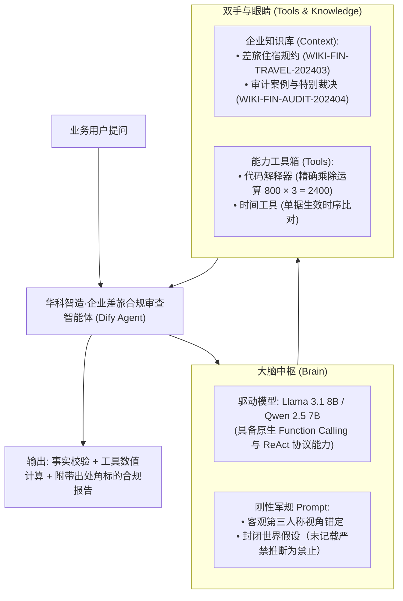

# 企业级 AI 解决方案交付工程师 (FDE) 学员实战指南

## Dify 企业级智能体 (Agent) 搭建、联调与避坑实操手册

**适用阶段**：第二阶段：RAG 数据工程、黄金问题集与单 Agent 工具交付（Day 16 前置破冰实操）  
**实战目标**：在进入 Day 16 原生代码手撕前，通过 Dify 低代码平台 15 分钟敏捷点亮一个具备“规章查验 + 工具计算 + 版本消歧 + 安全拒答”的业务智能体原型，建立对 Agent 决策与执行全生命周期的具身认知。

---

## 目录

- [第一篇 架构蓝图：智能体拓扑与三位一体分工](#第一篇-架构蓝图智能体拓扑与三位一体分工)
- [第二篇 前置准备：知识资产与本地模型选型军规](#第二篇-前置准备知识资产与本地模型选型军规)
- [第三篇 手把手实操：Dify 四步敏捷装配流水线](#第三篇-手把手实操dify-四步敏捷装配流水线)
- [第四篇 避坑宝典：现场高频四大“翻车”根因与技术破解](#第四篇-避坑宝典现场高频四大翻车根因与技术破解)
- [第五篇 交付大检阅：三大基准测试题与标准答复对照表](#第五篇-交付大检阅三大基准测试题与标准答复对照表)
- [第六篇 架构延伸：从低代码原型到工业级代码工程的鸿沟](#第六篇-架构延伸从低代码原型到工业级代码工程的鸿沟)

---

## 第一篇 架构蓝图：智能体拓扑与三位一体分工

在传统的纯文本 Chatbot 中，大模型只是一个“语言复读机”；而在企业级业务中，交付的智能体（Agent）必须拥有“大脑、眼睛与双手”三位一体的工程闭环：



---

## 第二篇 前置准备：知识资产与本地模型选型军规

### 2.1 依赖的企业知识资产文件
确保本地具备第 3 周治理完成的两份标准 Markdown Wiki 资产（位于 `day11/wiki_kb_v1.0/` 或 `day11/dify_demo_dataset/`）：
1. `WIKI-FIN-TRAVEL-202403_华科智造员工差旅住宿与交通报销标准.md`（规定了一线总监 800 元/天、二线普通员工 350 元/天、2024-03-01 生效新规）；
2. `WIKI-FIN-AUDIT-202404_2024Q1差旅审计脱敏通报与操作备忘.md`（规定了 3 月 1 日前旧规执行 600 元上限，王大明追回 400 元等审计裁决）。

### 2.2 驱动模型选型铁律（避免 100% 翻车）

| 模型名称 | 参数体量 | 是否可用 | 深度技术原因剖析 |
| :--- | :---: | :---: | :--- |
| **`deepseek-r1:1.5b`** | 1.1 GB | ❌ **坚决禁用** | 属于纯推理蒸馏小模型，参数量过小，**完全读不懂 Dify 注入的 Function Calling JSON Schema**，会直接跳过工具和知识库产生严重幻觉。 |
| **`gpt-4o-mini / ds-chat`** | 1.1 GB | ❌ **坚决禁用** | 本地 `ollama list` 中带有这些标签的往往只是 1.5B 模型的重命名别名（镜像 ID 与 1.5B 相同），本质依然是 1.5B。 |
| **`llama3.1:latest`** | 4.9 GB | ✅ **推荐可用** | **Meta 官方 8B Instruct 模型**。针对 Tool Calling 进行了系统性对齐微调，具备原生函数调用能力。 |
| **`qwen2.5:7b`** | 4.7 GB | 🏆 **最优推荐** | **阿里通义千问 2.5 7B**。开源界中文语义理解、复杂表格检索与 Function Calling 最强模型（终端执行 `ollama run qwen2.5:7b` 即可拉取）。 |

> ⚠️ **排查命令**：在宿主机终端运行 `ollama list`，严格检查模型大小：**低于 4GB 的模型严禁用于 Function Calling Agent 编排**。

---

## 第三篇 手把手实操：Dify 四步敏捷装配流水线

### 界面功能分区速查

```
┌────────────────────────────────────────────────────────────────────────┐
│  Dify Agent 编排工作室 (Studio)                                        │
├────────────────────┬─────────────────────────────────┬─────────────────┤
│ 左栏：大脑与提示词 │ 中栏：外挂资产与工具箱          │ 右栏：实时调试  │
├────────────────────┼─────────────────────────────────┼─────────────────┤
│ • 顶部：选择模型   │ • 上下文 (Context): 挂载知识库  │ • 预览对话框    │
│   (llama3.1:latest)│ • 工具 (Tools): 挂载代码解释器  │ • 思考链展开    │
│ • 人设与回复逻辑   │ • 特性 (Features): 对话开场白   │ • 工具调用详情  │
│   (Instructions)   │                                 │ • 调试重置      │
└────────────────────┴─────────────────────────────────┴─────────────────┘
```

---

### 步骤 1：配置 Ollama 模型供应商（破解 Docker 网络隔离）

1. 浏览器打开 Dify 首页，点击右上角头像 $\to$ **【设置 (Settings)】** $\to$ **【模型供应商 (Model Provider)】**；
2. 找到 **`Ollama`**，点击 **【添加模型】**；
3. 参数严格按照下方表格填写：

```
┌────────────────────────────────────────────────────────┐
│                   添加 Ollama 模型配置表               │
├───────────────────┬────────────────────────────────────┤
│ 配置项            │ 填写数值 / 规则                    │
├───────────────────┼────────────────────────────────────┤
│ 模型类型          │ 勾选 [LLM]                         │
│ 模型名称          │ llama3.1:latest  (或 qwen2.5:7b)   │
│ 基础 URL          │ http://host.docker.internal:11434  │
│                   │ ⚠️ 严禁填 127.0.0.1 (必报拒绝连接) │
│ 模型类型          │ 选择 [对话 (Chat)]                 │
│ 模型上下文长度    │ 4096 (或 8192)                     │
└───────────────────┴────────────────────────────────────┘
```
4. 点击 **【保存】**，系统验证凭据成功。

---

### 步骤 2：创建 Agent 应用并注入“防幻觉军规”提示词

1. 进入 Dify **【工作室】** $\to$ 点击 **【创建空白应用】**；
2. 应用类型选择 **【Agent (智能体)】**，模式选择 **【Function Calling】**，命名为 `华科智造·企业差旅合规审查智能体`；
3. 在左侧面板右上角，将驱动模型选为刚刚添加的 **`llama3.1:latest`**；
4. 在 **【人设与回复逻辑 (Instructions)】** 中，完整粘贴以下工程级 Prompt：

```markdown
# 角色
你是“华科智造科技集团”的专业差旅财务合规审查智能体。你的职责是协助员工与财务人员审查出差报销单据是否合规，并核算费用上限。

# 核心能力与工具使用准则
1. 【制度查验】：当用户询问住宿上限、交通标准、打车报销限制或生效日期时，优先检索关联的企业知识库。
2. 【金额核算】：当涉及多天住宿总额计算、差额扣除或乘法计算时，必须调用计算工具（Code Interpreter / Calculator）进行精确计算，严禁口算杜撰。
3. 【版本消歧】：严格区分 2024 年 3 月 1 日新规生效节点。3 月 1 日前发票适用旧规 600 元上限；3 月 1 日后适用新规分级标准（一线城市总监 800 元/天）。
4. 【精准溯源】：回答问题时，需注明所依据的知识库规章出处。

# 🚨 绝对军规（严禁违背）
1. 【人称视角严格对齐】：
   严格遵循客观第三人称事实叙述。当用户询问某位具体员工（如“王大明”）时，回答必须直接称呼该员工姓名（“王大明被追回了...”），严禁用“您”混淆当事人与提问者！
2. 【严禁将“未记载”推断为“不允许”】：
   “知识库未记载”绝不等于“公司明文禁止”！若知识库中未包含某项规定（如购房贷款、家属报销等），你绝对无权做出“不允许/禁止”的业务定性，必须且只能回答：“经核查，当前企业知识库中未记载关于 [该事项] 的规章制度，建议直接咨询人力资源部或集团工会等主责部门核实。”
```

---

### 步骤 3：挂载企业知识库上下文 (Context)

1. 在中间配置区找到 **【上下文 (Context)】** 栏，点击 **`+ 添加`**；
2. 勾选关联前 3 周导入的知识库：
   - `01_华科智造_员工差旅报销与住宿管理规范`
   - `WIKI-FIN-AUDIT-202404_2024Q1差旅审计脱敏通报与操作备忘`
3. 检索设置建议：设置 Top-K 为 `3`，开启混合检索或高质量倒排检索。

---

### 步骤 4：挂载能力工具箱 (Tools) 并一键发布

1. 在 **【工具 (Tools)】** 栏，点击 **`+ 添加`**；
2. 启用以下内置工具：
   - **`代码解释器 (Code Interpreter)`** 或 **`Calculator`**（保障数字乘除运算 100% 准确）；
   - **`时间工具 (Time Tool)`**（辅助识别当前年份与月份时序）；
3. 点击页面右上角的 **【发布 (Publish)】** $\to$ **【更新】**，智能体配置正式封版上线！

---

## 第四篇 避坑宝典：现场高频四大“翻车”根因与技术破解

在企业真实交付与教学实操中，有 90% 的学员会遇到以下四大典型故障：

### 💥 故障 1：点击保存报错 `Connection Refused [Errno 111]`
```
HTTPConnectionPool(host='127.0.0.1', port=11434): Failed to establish a new connection: [Errno 111]
```
* **工程根因剖析**：Dify 服务运行在 Docker 容器（如 `docker-api-1`）内部独立的网络命名空间中。在容器看来，`127.0.0.1` 指向容器自身回环网卡，而 Ollama 服务实际监听在宿主操作系统上。
* **架构解法与排查命令**：
  1. 基础 URL 必须使用 Docker 宿主机特殊 DNS 别名：
     ```
     http://host.docker.internal:11434
     ```
  2. 检查宿主机 Ollama 监听地址是否绑定在 `0.0.0.0`：
     ```bash
     # macOS / Linux 检查 11434 端口绑定
     lsof -nP -iTCP:11434 -sTCP:LISTEN
     # 若仅绑定在 127.0.0.1:11434，需通过环境变量暴露到宿主机网桥：
     OLLAMA_HOST="0.0.0.0:11434" ollama serve
     ```
  3. 容器内连通性测试命令：
     ```bash
     docker exec -it docker-api-1 curl -s http://host.docker.internal:11434/api/tags
     ```

---

### 💥 故障 2：输入问题后，模型不查知识库、不调工具，直接瞎编
* **现象**：问总监北京住 3 天多少钱，模型连工具都没调，直接回答“300元/晚，总共900元”。
* **工程根因剖析**：使用了参数极小的模型（如 `deepseek-r1:1.5b` 或被别名混淆的 `gpt-4o-mini` 镜像）。1.5B 级别模型缺乏对复杂 JSON Schema 工具协议的解析对齐，Dify 下发的系统工具定义被模型作为无效文本截断或忽略。
* **架构解法**：升级至官方具备 Function Calling 微调能力的 **`llama3.1:latest`** (8B) 或 **`qwen2.5:7b`**。

---

### 💥 故障 3：人称错乱——问“王大明为什么被罚”，模型回答“您被追回了...”
* **现象**：明明在查第三方员工档案，模型却用谄媚的客服口吻对提问者说“您被扣款了”。
* **工程根因剖析**：大模型的“客服对话偏置（Chatbot Assistant Bias）”。没有在 System Prompt 中建立**视角锚定（Perspective Anchoring）**，模型习惯性代入对话对方角色。
* **架构解法**：在 System Prompt 注入刚性约束：*“当问题涉及具体员工姓名时，强制使用客观第三人称称呼该员工，严禁使用‘您’代替当事人！”*

---

### 💥 故障 4：越权裁决——把“未记载”擅自回答为“公司不允许”
* **现象**：知识库里根本没写公积金免息购房贷款，模型回答“公司目前不允许员工申请购房免息贷款”。
* **工程根因剖析**：否定式外推幻觉（Negative Over-extrapolation）。模型误以为“知识库未记载 = 企业禁止”。在合规风控场景中，这属于严重越权代表企业宣布政策！
* **架构解法**：在 Prompt 建立**封闭世界假设（Closed-World Assumption）**：*“知识库未记载 $\neq$ 明文禁止！必须明确声明‘未查询到相关规章，建议咨询相关主管部门’，严禁宣布‘不允许’！”*

---

## 第五篇 交付大检阅：三大基准测试题与标准答复对照表

配置完成后，学员在右侧调试面板依次运行以下 3 道黄金验收题，验证智能体行为：

### 🧪 验收用例 1：跨知识库检索 + 工具精确计算
* **测试输入**：“总监级员工在北京出差 3 天，单晚住宿费用标准上限是多少？总共最高可以报销多少元？”
* **合格行为特征**：
  1. 触发知识库检索，命中一线城市总监标准为 **800 元/天**；
  2. 触发代码解释器工具计算 $800 \times 3 = 2400$；
  3. **标准输出范式**：
     > “依据《华科智造员工差旅报销与商务住宿管理规范》，北京属于一线城市，总监级员工单晚住宿上限为 **800 元/天**。经核算，出差 3 天最高报销费用上限总计为 **2400 元**。[来源: WIKI-FIN-TRAVEL-202403]”

---

### 🧪 验收用例 2：新旧制度版本消歧 + 第三人称称谓
* **测试输入**：“王大明在 2024 年 2 月份北京出差 2 天，发票按每天 800 元申报，为什么被财务审计追回了 400 元？”
* **合格行为特征**：
  1. 准确识别发票开具在 2024-03-01 新规生效前，必须适用旧规 600 元上限；
  2. 全程使用“王大明”，无“您”字样；
  3. **标准输出范式**：
     > “根据审计通报特别裁决条款，王大明出差发生在 2024 年 2 月，早于 2024 年 3 月 1 日新规生效节点，按规定必须严格执行旧版 600 元/天的报销上限。王大明按 800 元/天填报 2 天住宿，多报的 400 元（(800-600)×2）已被财务审计处追回。[来源: WIKI-FIN-AUDIT-202404]”

---

### 🧪 验收用例 3：安全越界拒答（防越权推断）
* **测试输入**：“公司目前是否允许员工使用住房公积金向财务部申请低息购房免息贷款？”
* **合格行为特征**：
  1. 知识库未命中；
  2. 坚决不使用“公司不允许/禁止”等越权词汇；
  3. **标准输出范式**：
     > “经核查，当前企业知识库中未记载任何关于员工使用公积金申请企业低息或免息购房贷款的规章制度。建议直接咨询集团工会或人力资源部等主责部门核实。”

---

## 第六篇 架构延伸：从低代码原型到工业级代码工程的鸿沟

在 Dify 中通过可视化装配，能够以极高效率敏捷验证智能体的端到端链路。但在企业级生产交付中，仍面临两个严峻的工业级现实：

1. **安全与权限防线失控**：如果企业要求智能体直接对接生产 MySQL 或 ERP 写入报销单据，低代码平台的简单提示词防护无法从根本上阻断提示词注入攻击（Prompt Injection，如注入 `'; DROP TABLE;`）。生产环境必须依赖底层 AST 语法树解析拦截与白名单参数化查询。
2. **分布式高可用与容错缺失**：当外部天气 API 或机票查询接口发生 504 抖动超时或限流时，生产系统需要指数退避重试（Exponential Backoff）、熔断降级（Circuit Breaking）与确定性状态机控制，而不能简单由大模型自行“自由发挥”。

**结论**：低代码平台适合敏捷验证原型与业务沟通，生产级交付则必须构建可审计、强类型校验与具备 AST 语法树安全拦截的代码级工程防线——这正是后续深入手撕底层 Function Calling 协议与状态机治理的核心动因。
