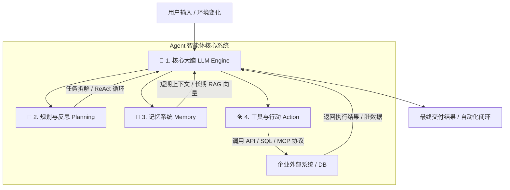

# 《AI Agent 架构与构建核心知识全景》

> **适用对象**：企业技术主管、交付工程师、架构师、产品/项目经理  

---

## 🧭  课程路线图

| 模块     | 核心主题                              | 讲授重点                                   |
|:------ |:--------------------------------- |:-------------------------------------- |
| **01** | **范式转移**：从 LLM ChatBot 到 AI Agent | 从“只能回答”到“能办业务”                         |
| **02** | **四梁八柱**：Agent 核心四大组件解构           | 大脑、规划、记忆、工具与 MCP 协议                    |
| **03** | **选型指南**：主流技术框架全景对比               | Dify vs LangGraph vs AutoGen vs CrewAI |
| **04** | **业务落地**：企业级三大典型应用场景              | 智能业务办理、Data Agent、Deep Research        |
| **05** | **工程避坑**：生产环境落地四大难点               | 幻觉控制、死循环防护、成本/延迟、Langfuse Trace        |
| **06** | **实战模拟**：5分钟 Agent 闭环运行演示         | 数据查询 + 业务规则判断 + 自动发邮件                  |
| **07** | **总结互动**：核心认知升维与 Q&A              | 总结口诀与现场交流                              |

---

# 01. 范式转移：从 LLM ChatBot 到 AI Agent

### ❓ 核心痛点：为什么我们只用大模型对话框不够？

> **用户需求**：“帮我分析一下上个季度武汉地区的销售下滑原因，并给供应链主管发一封预警邮件。”

```
【传统 ChatBot】 ❌ 给出一段模棱两可的分析文字，提示“我没有权限访问数据库，也无法发送邮件”。
【AI Agent】     ✅ 自动拆解任务 ➔ 查数据库 ➔ 计算下滑率 ➔ 自动撰写并发送邮件 ➔ 汇报执行结果。
```

---

### ⚖️ 传统 LLM vs AI Agent 核心区别

| 维度       | 传统 ChatBot (LLM)               | AI Agent (智能体)                |
|:-------- |:------------------------------ |:----------------------------- |
| **定位**   | **知识咨询师**（回答问题）                | **数字员工**（执行任务）                |
| **交互模式** | 一问一答（Single-turn / Multi-turn） | 感知-思考-行动循环闭环（Autonomous Loop） |
| **能力边界** | 受限于训练数据与 Context Window        | 可通过 API / 工具连接无限的外部真实世界       |
| **决策方式** | 概率生成下一个 Token                  | 具备任务拆解、自我纠错与长流程规划能力           |

> 💡 **一句话记忆**：“LLM 是智能体的**大脑**，而 Agent 是给大脑装上了 **手脚（API/工具）** 和**记忆（数据库）**。”

---

# 02. 四梁八柱：Agent 核心四大组件解构

$\Large \text{Agent} = \text{大脑 (LLM)} + \text{规划 (Planning)} + \text{记忆 (Memory)} + \text{工具 (Action)}$



---

### 🧩 组件详解

#### 1. 🧠 大脑 (LLM / Reasoning Engine)

* **作用**：意图理解、逻辑推理、决策调度。
* **选型关键**：推理能力（Reasoning）直接决定 Agent 决策上限。

#### 2. 🧭 规划与反思 (Planning & Self-Reflection)

* **任务拆解 (Decomposition)**：将复杂目标拆解为子任务链。
* **ReAct 思考范式**：
  $\text{Reason (思考)} \longrightarrow \text{Act (行动)} \longrightarrow \text{Observe (观察反馈)} \longrightarrow \text{Loop (循环直至完成)}$
* **自我反思 (Reflection)**：检测上一步工具调用是否失败，自动修正参数重试。

#### 3. 💾 记忆机制 (Memory)

* **短期记忆**：对话上下文 Buffer（Context Window 调度）。
* **长期记忆**：向量数据库 (Milvus/Chroma) + RAG 知识库，沉淀用户 Profile 与业务规则。

#### 4. 🛠️ 工具与行动 (Tools & Action / MCP)

* **Function Calling**：结构化输出 JSON Schema。
* **MCP 协议 (Model Context Protocol)**：开放的“大模型-工具/数据源”通用连接标准接口。

---

# 03. 选型指南：主流技术框架全景对比

```
                             【Agent 技术选型图谱】
                                      │
           ┌──────────────────────────┴──────────────────────────┐
           ▼                                                     ▼
   【低代码/图形化平台】                                  【开源代码级框架】
 (快速验证/标准 Workflow)                              (复杂业务/生产级定制)
   ├── Dify (首选)                                       ├── LangGraph (状态图/人机回环)
   ├── Coze (字节扣子)                                    ├── AutoGen (多智能体对话)
   └── Flowise                                           ├── CrewAI (角色分工)
                                                         └── LlamaIndex Agent (数据驱动)
```

---

### 📊 四大主流代码框架对比表

| 框架名称                 | 核心设计范式                   | 最佳适用场景           | 关键优势                                      |
|:-------------------- |:------------------------ |:---------------- |:----------------------------------------- |
| **LangGraph**        | **状态图 (State Graph)**    | 生产级复杂业务、带分支/循环流程 | 支持状态持久化、完美支持 **人机回环 (Human-in-the-Loop)** |
| **AutoGen**          | **多智能体对话 (Multi-Agent)** | 模拟多角色讨论对账、自动代码生成 | 多个 Agent 自发对话碰撞，适合高复杂度自洽任务                |
| **CrewAI**           | **基于角色的团队 (Role-based)** | 敏捷团队模拟（产品+开发+测试） | 贴合企业组织架构，任务分配明确，易于上手                      |
| **LlamaIndex Agent** | **数据/检索驱动 (Data-first)** | 深水区 RAG、复杂数据分析   | 对结构化/非结构化数据的检索与 API 结合极强                  |

> 📌 **落地建议**：简单拖拽验证选 **Dify**；生产环境复杂长流程，推荐 **LangGraph**。

---

# 04. 业务落地：企业级三大典型应用场景

### 场景 1：🎧 从“答疑客服”升级为“业务办理数字员工”

* **过去**：告诉用户“退货请在 App 提交申请”。
* **Agent 闭环**：
  $\text{接收请求} \to \text{调用订单 API 查状态} \to \text{规则校验} \to \text{生成 ERP 工单} \to \text{推送退货地址}$

---

### 场景 2：📊 Text-to-SQL 与企业数据分析助手 (Data Agent)

* **业务提问**：“对比今年和去年武汉分公司的季度销售额。”

* **Agent 执行链**：
  
  ```
  自然语言 ➔ 读取 DB Schema ➔ 生成标准 SQL ➔ 执行查询 ➔ Python Matplotlib 绘图 ➔ 生成分析结论
  ```

---

### 场景 3：⚙️ Deep Research 深度研究与自动化报告生成

* **应用**：金融研报、竞品调研、标书分析。
* **Agent 循环**：搜索外网/内网 ➔ 提取碎片信息 ➔ 发现数据缺失 ➔ 补充二次检索 ➔ 排版导出 Word/PPT。

---

# 05. 工程避坑：生产环境落地四大难点

```
+------------------------------------+------------------------------------+
| 🔴 难点 1: 幻觉与不可控性           | 🟢 应对策略: Workflow + 人机回环    |
| Agent 乱填 API 参数 / 产生幻觉     | 确定性节点走硬编码，高危节点人工审批 |
+------------------------------------+------------------------------------+
| 🔴 难点 2: 死循环与工具超时        | 🟢 应对策略: 熔断机制 + Schema 强校验|
| 外部 API 报错 500 导致反复无限重试 | 限制 Max Iterations (如 max=5)     |
+------------------------------------+------------------------------------+
| 🔴 难点 3: 延迟高与 Token 成本暴涨  | 🟢 应对策略: 模型分级路由 (Router) |
| 多轮思考响应慢，消耗大量 Token    | 轻量任务用小模型，复杂推理调用大模型 |
+------------------------------------+------------------------------------+
| 🔴 难点 4: 黑盒运行无法调试        | 🟢 应对策略: Langfuse 全链路 Trace |
| 不知道 Agent 在第几步走偏         | 部署 LLMOps 可观测工具，监控每一步  |
+------------------------------------+------------------------------------+
```

---

# 06. 实战模拟：5分钟 Agent 闭环运行演示

### 💡 演示用例：“销售数据查询与异常预警 Agent”

> **用户指令**：“帮我查询上个月武汉地区的销售额，如果低于 50 万元，自动给区域经理发一封预警邮件。”

```
[Agent 思考日志 (Trace Log)]
------------------------------------------------------------------------
[Step 1 - Thinking] 用户需要查询上月武汉销售额，我需要调用数据库查询工具。
[Step 1 - Action]   Call Tool: Query_Sales_DB(region="Wuhan", period="2026-08")
[Step 1 - Observe]  DB Result: {"sales_amount": 420000, "status": "success"}

[Step 2 - Thinking] 查询结果为 42 万元，对比规则阈值 50 万元，符合低于条件(42 < 50)。
                    需要触发邮件工具给区域经理发送预警。
[Step 2 - Action]   Call Tool: Send_Email(to="manager@wuhan.com", 
                                        subject="销售额预警", 
                                        content="8月销售额42万，低于50万预警线")
[Step 2 - Observe]  Email Result: {"message_id": "MSG_99281", "status": "sent"}

[Step 3 - Final Output] 
“上月武汉地区销售额为 42 万元，已触发预警规则，预警邮件已成功发送至经理邮箱。”
------------------------------------------------------------------------
```

---

# 07. 总结与 Q&A 互动

### 🔑 生产级 Agent 落地三大原则

1. **架构务实**：确定性流程用 **Workflow** 编排，灵活性交给 **LLM** 决策。
2. **安全边界**：涉及转账、删除数据等高危操作，必须加入 **Human-in-the-Loop**。
3. **闭环验证**：可落地的 Agent 必须拥有 **受评测保护的 Golden Dataset** 与 **Langfuse 全链路监控**。

---

### ❓ 现场 Q&A 交流

> **欢迎提出您感兴趣的问题：**
> 
> * *“我们的业务系统 API 格式很复杂，大模型调不准怎么办？”*
> * *“Dify 和 LangGraph 在真实项目中如何配合选型？”*
