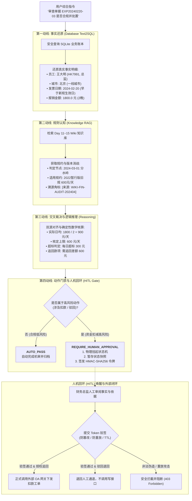

# Day 18 三位一体架构与人机回环 (HITL) 实战导读

👉 **实战核心脚本**：[`run_day18_triad_agent.py`](run_day18_triad_agent.py)

---

### 一、Day 18 架构拓扑：三位一体协同与四阶执行动线

针对企业严肃业务中“单一 RAG 只能查死知识，单一 Text2SQL 只能查死数字，单一 API 缺乏事实依据”的痛点，本实战脚本实现了完整的**三位一体架构 (The Triad Architecture)** 与**四阶闭环动线**：



---

### 二、讲义五篇核心内容 100% 覆盖对照表

| 讲义篇章 | 理论与架构要求 | 本脚本落地实现的生产级代码机制 |
| :--- | :--- | :--- |
| **第一篇 架构升维** | 三位一体（知识库+数据库+API）破除“盲人摸象”单一技术局限 | `TriadBusinessAgent` 同时注入 `Wiki RAG 规约检索器`、`SafeDatabaseGateway 安全查库网关`、`ExternalOAGateway 外部微服务动作集` 三大支撑底座。 |
| **第二篇 动线推演** | 四阶闭环动线：规则认知 $\to$ 事实还原 $\to$ 交叉裁决 $\to$ 业务闭环 | 严格编排四步方法：`_stage2_database_text2sql` (查明细) $\to$ `_stage1_knowledge_rag` (查规约并消歧) $\to$ `_stage3_cross_reasoning` (比对核算) $\to$ 动作门禁。 |
| **第三篇 风险控制** | 读写分离门禁与人机回环 (HITL) 挂起恢复机制 | • 合规只读单据自动放行 (`AUTO_PASS`)；<br>• 涉及追回扣款的操作一律物理挂起 (`SUSPEND`)；<br>• 实现带 HMAC-SHA256 签名的防伪令牌管理器 `SignedApprovalTokenManager`，支持 TTL 时效与防重放单次消费。 |
| **第四篇 代码实战** | Pydantic 契约模型与核心引擎 | 采用 `AuditDecisionPayload` 强类型模型封装裁决明细、法条溯源角标；实现 `resume_human_approval` 凭 Token 唤醒状态机并调用外部 OA 下发工单。 |
| **第五篇 验收标准** | 4 项硬核验收 Checklist (四源打通、角标引用、HITL门禁、Token恢复) | 单元测试全覆盖：合规直通、违规挂起、人工授权恢复、非法/重放攻击拦截、人工驳回 5 大场景，断言全部通过。 |

---

### 三、与 Day 1 ~ Day 17 前序资产的深度互通

1. **承接 Day 11 ~ Day 15 (企业非结构化 Wiki 资产库)**：
   - 内置并精准消歧：
     - `WIKI-FIN-TRAVEL-202403`：2024最新修订版（一线城市总监上限 800 元/天，经理 550 元/天）；
     - `WIKI-FIN-AUDIT-202404` 附录 C：历史制度过渡期冲突特别裁决（2024年3月1日之前单据严格执行旧规上限 600 元/天）。
   - 裁决明细 100% 携带 `[来源: 文档名-章节名]` 标准角标。
2. **承接 Day 16 (安全 Text2SQL + API 网关)**：
   - `SafeDatabaseGateway` 继承 Day 16 安全 AST 校验规范，预置周建华、王大明、赵小雪等标准业务流水；
   - `ExternalOAGateway` 承接 Day 16 外部微服务网关，支持工单下发、审批人鉴权与流水回传。
3. **承接 Day 17 (工作流状态机 + Langfuse APM 遥测追踪)**：
   - 贯穿 `LangfuseTraceRecord`，将四阶动线抽象为 `DB_QUERY`、`KNOWLEDGE_RAG`、`CALC_REASONING`、`HITL_GATE` 阶段 Span；
   - 自动统计端到端时延、Token 消耗量与货币成本（$/Request）。

---

### 四、现场 4 大验收场景全流程实跑验证

在终端执行：
```bash
python3 培训文档/Day18/run_day18_triad_agent.py
```

#### 场景 1：周建华合规单据 (自动化机审通过)
- **事实**：周建华 (总监)，上海 (一线城市)，2024-03-15 出差 3 天，申报 2400.0 元。
- **裁决**：适用 2024 最新规上限 800 元/天，实际日均 800 元/天。
- **门禁**：`AUTO_PASS`，无扣款风险，系统自动完成只读归档，无需人工介入。

#### 场景 2：王大明历史跨版本单据违规审查 (触发人机回环挂起 -> 财务总监人工授权)
- **事实**：王大明 (总监)，北京 (一线城市)，2024-02-20 出差 2 天，申报 1800.0 元。
- **消歧**：出差日期为 2024-02-20，早于 2024-03-01，严格执行 2022 暂行版旧规 600 元/天。
- **核算**：实际申报 900 元/天，单日超标 300 元，总计需追回 600 元。
- **挂起**：触发 `REQUIRE_HUMAN_APPROVAL`，工作流物理挂起，生成加密 Token（如 `TOKEN-HITL-97BF11C4-e5fe0b0ce1f4`）。
- **人工恢复**：财务总监李敏携带 Token 签署通过，状态机唤醒，正式调用外部 OA 接口下发工单 `OA-CLAWBACK-xxx`。

#### 场景 3：安全攻防测试——防重放攻击与非法 Token 拦截
- **重放攻击**：攻击者试图重放已消费的 Token 再次下发扣款 $\to$ 触发【防重放黑名单】安全拦截。
- **伪造攻击**：攻击者提交未经 HMAC 签名的伪造 Token $\to$ 触发【认证失败】安全阻断。

#### 场景 4：人工审查驳回分支测试
- **场景**：违规单据挂起后，审批人发现其附带总经理特批邮件，点击【驳回处罚退回复核】。
- **闭环**：状态机记录驳回原因并归档，不调用任何外部写接口。
