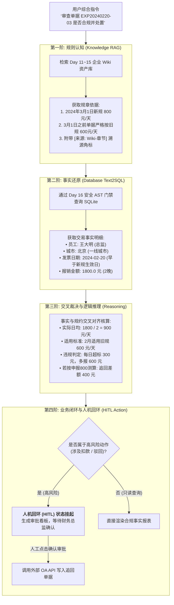
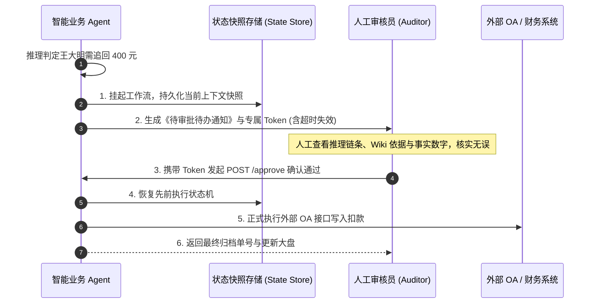

# 企业级 AI 解决方案交付工程师 (FDE) 学员实战讲义

## Day 18：三位一体架构攻坚：知识库+数据库+API全链路协同 Agent

**所属模块**：第二阶段：RAG 数据工程、黄金问题集与单 Agent 工具交付  
**学习周期**：第 4 周 / 第 18 天（8 学时 / 【阶段大产出攻坚·Day 1】：三位一体架构打通 + 跨多源数据对齐 + 人机回环 HITL 审批挂起）  
**面向学员**：初中级交付工程师 (Junior FDE) / 资深技术骨干 / 解决方案架构师  
**前置承接**：已完成第 3 周（Wiki 知识库微服务）与本周 Day 16（安全 Text2SQL/API 武器库）及 Day 17（确定性编排与 Langfuse APM）。所有积木与防御部件已全部就绪！今天吹响**第二阶段商业级大产出的攻坚号角——将“非结构化制度知识库”、“结构化业务数据库”与“外部微服务 API”进行三位一体深度融通，落地具备人机回环（HITL）的高可用业务智能体！**

---

## 🎯 学习目标与交付物约定

完成本模块课程与实操工作坊后，每位学员应达成以下关键能力指标：

1. **掌握“三位一体 (The Triad Architecture)”大模型协同范式**：深刻理解企业严肃业务中“单一 RAG 只能查死知识”、“单一 Text2SQL 只能查死数字”的局限，掌握“先查规约 $\to$ 再查明细 $\to$ 交叉裁决 $\to$ 发起动作”的四阶闭环。
2. **掌握多源异构上下文对齐与实体消歧**：掌握将自然语言制度标准（如“一线城市总监住宿上限 800 元”）与数据库实体行（如 `city='上海', role='总监', amount=2400.0, days=3`）进行动态绑定的数学核算引擎。
3. **精通人机回环 (Human-in-the-Loop, HITL) 挂起与恢复机制**：对于高风险写操作（如罚款追回、OA 终审通过、资金拨付），建立“中断挂起 $\to$ 抛出带签名 Token $\to$ 人工审阅确认 $\to$ 状态机恢复执行”的安全防线。
4. **组内产出核心工程资产**：
   - [ ] 产出物：《三位一体企业级财务合规智能业务 Agent 核心原型 (`triad_business_agent.py`)》

---

## 目录

- [第一篇 架构升维：为什么企业级业务必然走向“三位一体”？](#第一篇-架构升维为什么企业级业务必然走向三位一体)
- [第二篇 动线推演：四阶闭环业务执行链路图谱](#第二篇-动线推演四阶闭环业务执行链路图谱)
- [第三篇 风险控制：人机回环 (HITL) 审批门禁与状态挂起设计](#第三篇-风险控制人机回环-hitl-审批门禁与状态挂起设计)
- [第四篇 生产级代码实战：三位一体智能合规 Agent 核心引擎](#第四篇-生产级代码实战三位一体智能合规-agent-核心引擎)
- [第五篇 课堂实战工作坊：4 人协同阶段大产出 Day 1 架构穿刺](#第五篇-课堂实战工作坊4-人协同阶段大产出-day-1-架构穿刺)

---

## 第一篇 架构升维：为什么企业级业务必然走向“三位一体”？

### 1.1 “盲人摸象”的孤立技术路线

在很多初级 AI 交付中，客户常提出综合性业务诉求：  
*“请帮我审核周建华和王大明上个月的差旅单据合不合规？如果超标了，算出超标多少并直接提交 OA 扣款预警！”*

此时，任何单一技术路线都会彻底瘫痪：
* **如果只用纯 RAG 知识库**：系统能背出《差旅规范》里总监上限 800 元，但它**根本不知道周建华实际花了多少钱、住了几天、发票日期是哪天**；
* **如果只用纯 Text2SQL 查库**：系统能查出王大明报销了 1800 元，但它**根本不知道公司制度里关于 2024 年 3 月 1 日新老制度更迭的消歧条款**；
* **如果只用外部 API 工具**：系统具备扣款接口，但缺乏事实判断与规则依据，盲目调用必然酿成客户投诉风暴。

```
                    ┌────────────────────────────┐
                    │  华科智造三位一体 Agent   │
                    └─────────────┬──────────────┘
                                  │
         ┌────────────────────────┼────────────────────────┐
         ▼                        ▼                        ▼
┌─────────────────┐      ┌─────────────────┐      ┌─────────────────┐
│ 非结构化知识库  │      │ 结构化数据库    │      │ 外部服务动作集  │
│ (Enterprise Wiki│      │ (Safe Text2SQL) │      │ (External APIs) │
├─────────────────┤      ├─────────────────┤      ├─────────────────┤
│ • 差旅住宿规约  │      │ • 员工真实报销表│      │ • OA 审批流接口 │
│ • 城市分级标准  │      │ • 财务审计流水  │      │ • 企微预警推送  │
│ • 新老版本更迭  │      │ • 历史扣款记录  │      │ • ERP 状态写回  │
└─────────────────┘      └─────────────────┘      └─────────────────┘
```

---

## 第二篇 动线推演：四阶闭环业务执行链路图谱

一个成熟的商业级智能业务 Agent，其底层的确定性状态流转遵循严格的**四阶执行动线**：



---

## 第三篇 风险控制：人机回环 (HITL) 审批门禁与状态挂起设计

### 3.1 为什么必须在写操作前设置“刹车片”？

在真实企业交付中，**只读操作可以全自动，写操作必须设门禁**。

如果允许大模型自主根据推理结果直接调用银行打款或员工罚款接口，哪怕系统准确率高达 99%，那 1% 的边缘误判就足以引发严重的法律合规风险。

**人机回环（Human-in-the-Loop, HITL）** 通过“状态持久化挂起”与“带鉴权 Token 恢复”机制，将人类权威嵌入自动化闭环：



---

## 第四篇 生产级代码实战：三位一体智能合规 Agent 核心引擎

本代码完整将 **Wiki 规章检索**、**只读安全查库**、**规则比对裁决** 与 **HITL 审批挂起机制** 熔炼为工业级一体化引擎：

```python
# agents/triad_business_agent.py
import time
import json
import uuid
from typing import Dict, Any, List, Optional
from pydantic import BaseModel, Field

# ==============================================================================
# 1. 结构化契约与审批模型
# ==============================================================================

class AuditDecisionPayload(BaseModel):
    ticket_id: str
    employee_name: str
    city: str
    expense_date: str
    claimed_amount: float
    applicable_limit_per_day: float
    daily_average: float
    is_compliant: bool
    violation_reason: Optional[str] = None
    clawback_amount: float = 0.0
    citations: List[str] = Field(default_factory=list)
    action_required: str  # 'AUTO_PASS' 或 'REQUIRE_HUMAN_APPROVAL'


# ==============================================================================
# 2. 三位一体协同智能体 (TriadBusinessAgent)
# ==============================================================================

class TriadBusinessAgent:
    """
    企业级三位一体协同智能体：
    - 通道 1 (Wiki RAG): 准确提取新旧规约标准与判定原则
    - 通道 2 (Text2SQL): 安全查询业务数据库获取真实报销流水
    - 通道 3 (Action & HITL): 执行规则交叉比对，高风险操作挂起等待人工签名
    """

    def __init__(self):
        # 挂起任务状态暂存区 (生产环境应持久化在 Redis 或 PostgreSQL)
        self.pending_approval_store: Dict[str, Dict[str, Any]] = {}

    # --------------------------------------------------------------------------
    # 子通道 1: Wiki 规章制度检索 (模拟 Day 15 高保真微服务)
    # --------------------------------------------------------------------------
    def _query_wiki_policy(self, city_tier: str, employee_role: str, expense_date: str) -> Dict[str, Any]:
        """依据日期与职级检索适用的合规制度标准与版本消歧"""
        # 核心消歧：严格区分 2024 年 3 月 1 日生效节点
        is_after_new_policy = expense_date >= "2024-03-01"

        if is_after_new_policy:
            limits = {"一线城市": 800.0, "二线城市": 600.0} if "总监" in employee_role else {"一线城市": 450.0, "二线城市": 350.0}
            standard = limits.get(city_tier, 350.0)
            citation = "WIKI-FIN-TRAVEL-202403 - 住宿标准明细与报销上限 (2024最新版)"
            version = "2024版新规"
        else:
            # 2024年3月1日之前单据严格执行旧规 600 元上限
            standard = 600.0 if "总监" in employee_role else 350.0
            citation = "WIKI-FIN-AUDIT-202404 - 版本冲突特别裁决条款 (旧规过渡期条款)"
            version = "2022暂行版旧规"

        return {
            "applicable_standard": standard,
            "version": version,
            "citation": citation
        }

    # --------------------------------------------------------------------------
    # 子通道 2: 数据库事实安全查询 (复用 Day 16 安全 SQL 范式)
    # --------------------------------------------------------------------------
    def _query_database_fact(self, ticket_id: str) -> Optional[Dict[str, Any]]:
        """模拟通过 AST 门禁安全读取的数据库流水明细"""
        db_mock = {
            "EXP20240315-01": {
                "ticket_id": "EXP20240315-01", "name": "周建华", "role": "总监",
                "city": "上海", "city_tier": "一线城市", "hotel_days": 3,
                "amount": 2400.0, "expense_date": "2024-03-15"
            },
            "EXP20240220-03": {
                "ticket_id": "EXP20240220-03", "name": "王大明", "role": "总监",
                "city": "北京", "city_tier": "一线城市", "hotel_days": 2,
                "amount": 1800.0, "expense_date": "2024-02-20"
            }
        }
        return db_mock.get(ticket_id)

    # --------------------------------------------------------------------------
    # 核心编排：全链路融合与推理核算
    # --------------------------------------------------------------------------
    def audit_expense_ticket(self, ticket_id: str) -> Dict[str, Any]:
        """主业务入口：先查规约，再查明细，执行交叉核验"""
        print(f"\n🔍 [1/4] 启动安全 Text2SQL 查询单据流水 [{ticket_id}] ...")
        record = self._query_database_fact(ticket_id)
        if not record:
            return {"success": False, "error": f"未在业务数据库中找到报销单号 {ticket_id}"}

        print(f"       -> 查明员工: {record['name']} ({record['role']}) | 城市: {record['city']} | 发票日期: {record['expense_date']}")

        print(f"📖 [2/4] 调度企业 Wiki 知识库检索制度依据并执行版本消歧...")
        policy = self._query_wiki_policy(
            city_tier=record["city_tier"],
            employee_role=record["role"],
            expense_date=record["expense_date"]
        )
        print(f"       -> 适用规范: {policy['version']} (每晚上限: {policy['applicable_standard']} 元)")
        print(f"       -> 溯源角标: [来源: {policy['citation']}]")

        print(f"⚖️ [3/4] 执行数学核算与合规性交叉比对推理...")
        hotel_days = max(record["hotel_days"], 1)
        daily_avg = record["amount"] / hotel_days
        limit = policy["applicable_standard"]

        is_compliant = daily_avg <= limit
        clawback = 0.0
        violation_reason = None

        if not is_compliant:
            clawback = record["amount"] - (limit * hotel_days)
            violation_reason = (
                f"单据日期为 {record['expense_date']}，依据规定必须执行【{policy['version']}】上限 {limit}元/天。"
                f"该员工申报日均 {daily_avg}元/天，单日超标 {daily_avg - limit}元，总计需追回多报差旅款 {clawback}元！"
            )

        # ----------------------------------------------------------------------
        # 风险决策与人机回环门禁 (HITL Gate)
        # ----------------------------------------------------------------------
        print(f"🛡️ [4/4] 评估操作风险等级并决定是否触发人机回环 (HITL) 门禁...")

        if is_compliant:
            action_code = "AUTO_PASS"
            status_msg = "✅ 合规通过：系统已自动完成机审归档。"
            approval_token = None
        else:
            action_code = "REQUIRE_HUMAN_APPROVAL"
            approval_token = f"TOKEN-HITL-{uuid.uuid4().hex[:8].upper()}"
            status_msg = f"⚠️ 违规异常拦截：涉及扣款与追回处置 ({clawback}元)，工作流已安全挂起，等待财务总监人工审批！"
            
            # 暂存工作流快照
            self.pending_approval_store[approval_token] = {
                "ticket_id": ticket_id,
                "employee_name": record["name"],
                "clawback_amount": clawback,
                "reason": violation_reason,
                "created_at": time.time()
            }

        payload = AuditDecisionPayload(
            ticket_id=ticket_id,
            employee_name=record["name"],
            city=record["city"],
            expense_date=record["expense_date"],
            claimed_amount=record["amount"],
            applicable_limit_per_day=limit,
            daily_average=daily_avg,
            is_compliant=is_compliant,
            violation_reason=violation_reason,
            clawback_amount=clawback,
            citations=[f"[来源: {policy['citation']}]"],
            action_required=action_code
        )

        return {
            "success": True,
            "status_message": status_msg,
            "approval_token": approval_token,
            "decision_payload": payload.dict()
        }

    # --------------------------------------------------------------------------
    # 人机回环：人工审核授权恢复接口
    # --------------------------------------------------------------------------
    def resume_human_approval(self, approval_token: str, auditor_name: str, approve: bool) -> Dict[str, Any]:
        """人工审核员核实后提交 Token，恢复并完成外部 API 写入闭环"""
        if approval_token not in self.pending_approval_store:
            return {"success": False, "error": "无效或已过期的审批令牌 Token！"}

        task = self.pending_approval_store.pop(approval_token)
        ticket_id = task["ticket_id"]

        if not approve:
            return {
                "success": True,
                "status": "REJECTED_BY_HUMAN",
                "message": f"财务总监 {auditor_name} 驳回了该笔追回决定，单据退回人工重新复核。"
            }

        # 模拟调用外部 OA / 财务记账系统正式写入追回
        time.sleep(0.02)
        external_oa_receipt = f"OA-CLAWBACK-{int(time.time())}"

        return {
            "success": True,
            "status": "APPROVED_AND_EXECUTED",
            "message": f"财务总监 {auditor_name} 签字授权成功！已正式下发 OA 追回单据：{external_oa_receipt}，追回金额：{task['clawback_amount']} 元。"
        }


# ==============================================================================
# 3. 现场运行与攻坚演示
# ==============================================================================

if __name__ == "__main__":
    print("=" * 85)
    print("🚀 Day 18 华科智造三位一体协同智能体 (知识库+数据库+API+HITL) 全链路实战")
    print("=" * 85)

    agent = TriadBusinessAgent()

    # --------------------------------------------------------------------------
    # 场景 1：周建华合规单据 (自动化机审通过)
    # --------------------------------------------------------------------------
    print("\n" + "#" * 40 + " 场景 1: 周建华合规报销单审查 " + "#" * 40)
    res_1 = agent.audit_expense_ticket("EXP20240315-01")
    print("\n📋 【智能体审查终审大盘】")
    print("• 判定状态：", res_1["status_message"])
    print("• 决策明细：", json.dumps(res_1["decision_payload"], ensure_ascii=False, indent=2))

    # --------------------------------------------------------------------------
    # 场景 2：王大明违规跨版本单据 (触发人机回环挂起 -> 财务总监人工审批授权)
    # --------------------------------------------------------------------------
    print("\n" + "#" * 40 + " 场景 2: 王大明旧规单据违规审查 " + "#" * 40)
    res_2 = agent.audit_expense_ticket("EXP20240220-03")
    print("\n📋 【智能体审查终审大盘】")
    print("• 判定状态：", res_2["status_message"])
    print("• 挂起令牌 Token：", res_2["approval_token"])
    print("• 违规归因说明：", res_2["decision_payload"]["violation_reason"])

    # 模拟人工介入审核
    token = res_2["approval_token"]
    print(f"\n👤 [人机回环] 财务总监在审批界面查验事实与溯源角标，确认处罚合理，点击【授权追回】...")
    resume_res = agent.resume_human_approval(token, auditor_name="李敏总监 (Finance Director)", approve=True)
    print("• 外部闭环结果：", resume_res["message"])
    print("=" * 85)
```

---

## 第五篇 课堂实战工作坊：4 人协同阶段大产出 Day 1 架构穿刺

> 📌 **阶段大产出核心任务**：  
> 各 4 人小组将本组垂直业务文档、数据库表与审批接口完整联调。  
> 必须跑通一次**完整的“边查文档规约、边查数据库明细、计算合规差异、挂起触发人机审批”**的端到端真实闭环！

### 5.1 4 人角色分工协同表

```
┌────────────────────────────────────────────────────────────────────────┐
│                   4 人小组阶段大产出 Day 1 攻坚协同表                  │
├───────────────────┬──────────────────────┬─────────────────────────────┤
│ 角色 A: 方案负责人 │ 角色 B: 架构负责人   │ 角色 C: 工程负责人          │ 角色 D: 质量负责人           │
│ (Spec Lead)       │ (Architect Lead)     │ (Tech Lead)                 │ (Quality Lead)              │
├───────────────────┼──────────────────────┼─────────────────────────────┤
│ 1. 负责审查核验公式 │ 1. 负责打通 RAG 与   │ 1. 编写三位一体 Agent 主类，│ 1. 编写 3 组真实测试用例，  │
│    与规约依据角标   │    Text2SQL 上下文   │    管理挂起状态与 Token 恢复│    验证合规与违规判定逻辑   │
│ 2. 标定人工审批必须 │ 2. 确保高风险操作物理│ 2. 联调外部 API 模拟端点，  │ 2. 模拟人工驳回与人工授权， │
│    展示的核心字段   │    隔离与幂等设计    │    输出结构化 Pydantic 数据 │    验证状态机恢复无死锁     │
└───────────────────┴──────────────────────┴─────────────────────────────┘
```

---

### 5.2 交付成果验收标准 (Checklist)

| 序号 | 交付成果物 | 判定达标标准 (Checklist) | 得分 (1-5分) |
| :---: | :--- | :--- | :---: |
| **1** | 三位一体闭环打通 | 成功在一个请求中同时完成知识库检索、数据库安全查验与逻辑比对。 | [ ] |
| **2** | 溯源角标与引用规范 | 每一个裁决结论均精准附带 `[来源: 文档名-章节名]`。 | [ ] |
| **3** | 人机回环 (HITL) 门禁 | 涉及扣款/超标处分等高风险动作，系统 100% 安全挂起，严禁越权直调写 API。 | [ ] |
| **4** | Token 状态恢复机制 | 审核员凭有效 Token 能够精准唤醒原任务并成功完成外部 API 写入。 | [ ] |

---

> 📌 **阶段技术承接说明**：  
> 今天我们攻克了智能体最关键的“三位一体架构贯通”。  
> • **Day 19**：我们将进入大产出第二天——**【报表输出、提测与混沌工程故障注入】**，为系统注入网络超时、恶意注入与畸变参数，锤炼生产级可用性！
