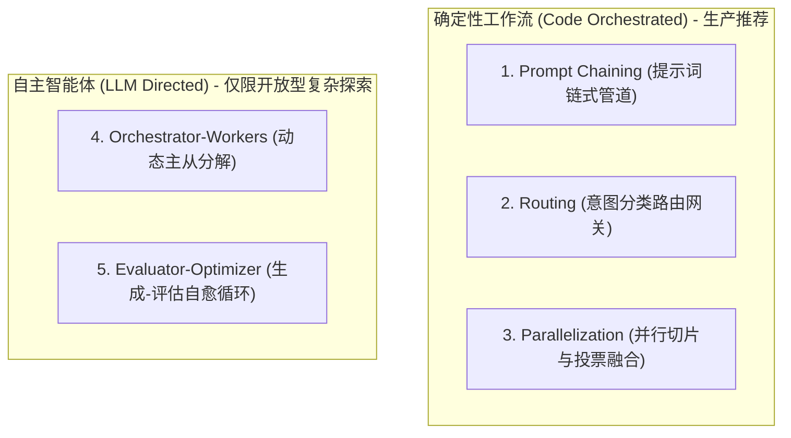

# Agent 架构第一红宝书/生产实践军规

Anthropic 官方发布的被工业界奉为 **“Agent 架构第一红宝书/生产实践军规”** 的文章标题为 **《Building Effective Agents》**（构建高效智能体）。

### 官方原文地址

* 🌐 **Anthropic 官方 Research 博客主页**：  
  [https://www.anthropic.com/research/building-effective-agents](https://www.anthropic.com/research/building-effective-agents)
* 🌐 **Anthropic 官方 News 镜像页**：  
  [https://www.anthropic.com/news/building-effective-agents](https://www.anthropic.com/news/building-effective-agents)

---

### 这篇军规的核心论断（为什么被称为“生产第一军规”？）

该文由 Anthropic 工程师团队（Erik Schluntz 等人）于 2024 年底联合发布，彻底厘清了 **“Workflows（确定性工作流）”** 与 **“Agents（自主智能体）”** 的本质分野：

#### 1. 概念界定：Workflows vs Agents

* **Workflows（工作流）**：通过 **预定义的代码逻辑路径（Predefined Code Paths）** 来编排大模型与工具。流程骨架由 Python/Java 代码牢牢锁死，大模型只在每个节点内部充当“数据提取器”或“语义翻译器”；
* **Agents（自主智能体）**：流程走向完全由**大模型自行决策（Dynamically Direct）**。

#### 2. 生产第一铁律（The Golden Rule）

> *"When building applications with LLMs, we recommend finding the simplest solution possible, and only increasing complexity when needed. This might mean not building agentic systems at all."*  
> **（在构建大模型企业生产系统时，从最简单的方案做起，仅在绝对必要时才引入复杂度——在绝大多数企业严肃业务中，甚至完全不应该使用自主 Agent，而必须采用确定性代码工作流！）**

#### 3. 文中提出的 5 大经典工程架构模式

这是我们在课程规划中，**Day 16 先带学员看清单 Agent 自由发挥的“伪调用翻车现场”，紧接着在 Day 17 必须手撕确定性状态机工作流编排（Workflow DAG）** 的理论基石。
