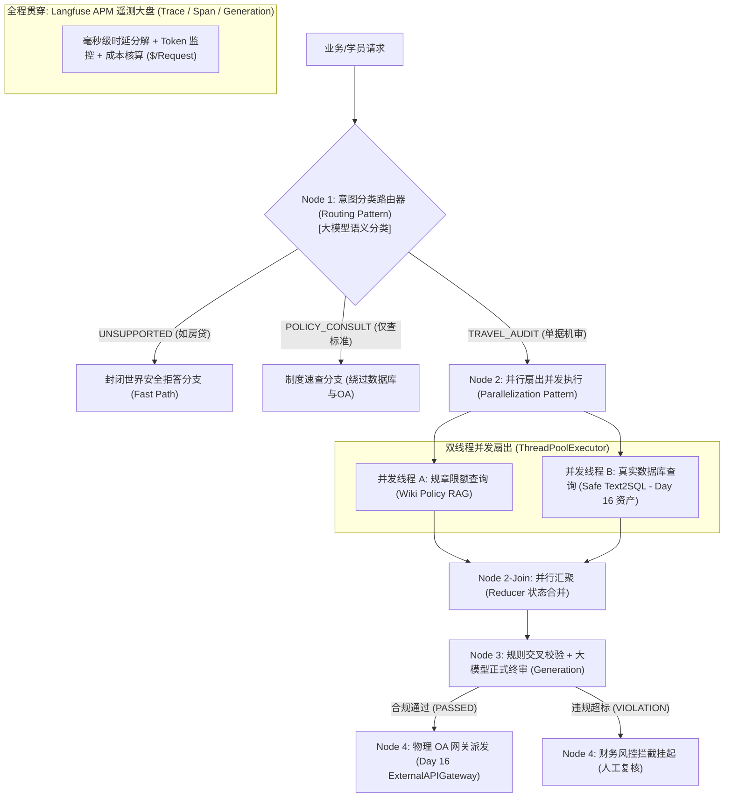

# Day 17 生产级确定性工作流与 Langfuse APM 追踪实战脚本

👉 **[`day17/run_day17_workflow.py`](file:///Users/lucas/Documents/项目/武汉柯莱特企培/day17/run_day17_workflow.py)**

---

### 一、本次脚本对讲义前四篇的“100% 全覆盖重构”

针对原讲义第五篇代码中“缺失路由、缺失并行、全靠假装执行”的短板，本脚本完成了全面升级：



| 讲义篇章                    | 本脚本落地实现的硬核技术特性                                                                                                                                                                                                                                                                              |
|:----------------------- |:------------------------------------------------------------------------------------------------------------------------------------------------------------------------------------------------------------------------------------------------------------------------------------------- |
| **第一篇（工作流基石）**          | 摒弃自由放飞的 ReAct，使用 **Python 状态机硬编码流程骨架**，保证执行顺序、可复现性与零死循环。                                                                                                                                                                                                                                    |
| **第二篇（Anthropic 四大模式）** | • **模式 1 链式处理 (Chaining)**：状态对象 `WorkflowState` 在节点间平滑递进。<br>• **模式 2 意图路由 (Routing)**：前置分类网关，精准分流机审流、制度咨询流与越界拦截。<br>• **模式 3 并行扇出 (Parallelization)**：使用 `ThreadPoolExecutor` **并发多线程同时查规章与查数据库**，再通过 Reducer 汇聚。<br>• **模式 4 评估裁决 (Evaluator)**：规则层硬核消歧（3月1日新旧规）+ 本地 Ollama LLM 撰写正式终审公文。 |
| **第三与四篇（Langfuse APM）** | • 实现完整的 **Trace 根节点 $\to$ Span 子过程 $\to$ Generation 大模型节点** 三级拓扑树。<br>• 实时统计每一步的输入输出 Token，按照标准费率折算美金成本，输出可视化 ASCII 监控甘特大盘。                                                                                                                                                                 |

---

### 二、与 Day 1 ~ Day 16 的无缝真实联动

本脚本彻底告别了“假装调用的 `time.sleep`”，真正打通了前序沉淀的代码与资产：

1. **联动 Day 11~15 Wiki 规章**：内置《华科智造员工差旅报销与商务住宿管理规范》（WIKI-FIN-TRAVEL-202403）一线总监 800 元/天、二线普通员工 350 元/天的标准矩阵；
2. **联动 Day 16 真实只读数据库**：步骤 2 直接 `from day16.run_day16_agent import SafeText2SQLEngine`，真正向本地 SQLite 发起带五重安全门禁的 SQL 查询；
3. **联动 Day 16 外部 API 网关**：步骤 4 直接调用 `ExternalAPIGateway.call_oa_approval_api`，携带超时、指数退避重试和审批单号回传。

---

### 三、终端 4 大用例全流程实跑验证（直连本地 Ollama Llama 3.1 8B）

执行 `python3 day17/run_day17_workflow.py`，跑通四个典型用例 ：

#### 场景 1：周建华合规单据（并行扇出 + 自动提交 OA）

```text
🚀 [启动工作流] 用户请求：请对员工周建华提交的单号 EXP20240315-01 进行全流程差旅合规性审计并审批。
  📍 [意图路由网关] -> 判定分类为: 【TRAVEL_AUDIT】
  ⚡ [并行扇出 Fork] 同时并发查询【企业Wiki规约】与【SQLite账本流水】...
  🤝 [并行汇聚 Join] 双路数据并发同步就绪，耗时: 22.69ms

📊 【Langfuse APM 生产全链路监控大盘 (Call Tree & Cost Telemetry)】
=========================================================================================================
  • Trace ID   : trace-64ad5b56578e
  • Workflow   : AuditFlow-EXP20240315-01
  • 操作人/会话: finance_lead_01 / sess_001
  • 端到端总时延: 11171.25 ms
  • 总 Token 消耗: 686 (输入: 467 | 输出: 219)
  • 本次调用总成本: $0.000201 USD
---------------------------------------------------------------------------------------------------------
阶段步骤名称                          节点类型            状态        耗时(ms)        Token(入/出)      折算成本(USD)
---------------------------------------------------------------------------------------------------------
1.Intent_Router                 ROUTER          🟢 SUCCESS 429.1ms       168/2           $0.0000264
2.Parallel_Wiki_Policy_RAG      PARALLEL_TASK   🟢 SUCCESS 19.9ms        110/28          $0.0000333
2.Parallel_Safe_Text2SQL        PARALLEL_TASK   🟢 SUCCESS 0.35ms        0/0             $0.0000000
2.Parallel_Fork_Join_Reducer    SPAN            🟢 SUCCESS 22.69ms       0/0             $0.0000000
3.Decision_Synthesis_LLM        GENERATION      🟢 SUCCESS 11068.1ms     189/177         $0.0001345
4.External_OA_Approval_Dispatch SPAN            🟢 SUCCESS 80.45ms       0/0             $0.0000000
=========================================================================================================
🎯 [工作流终审结论]：
【终审结论】：本次出差费用审计通过，费用合规（出差上海3天，日均800元符合一线总监上限）。
✅ 【物理OA写入成功】：审批单号 APP-1792376285-406 已归档入库。
```

#### 场景 2：王大明违规追回单据（新旧规消歧 + 风控拦截挂起）

```text
🚀 [启动工作流] 用户请求：请核验王大明单号 EXP20240220-03 的发票合规性，是否存在超额申报需追回？
  📍 [意图路由网关] -> 判定分类为: 【TRAVEL_AUDIT】
  ⚡ [并行扇出 Fork] 同时并发查询【企业Wiki规约】与【SQLite账本流水】...
  🤝 [并行汇聚 Join] 双路数据并发同步就绪，耗时: 20.32ms

阶段步骤名称                          节点类型            状态        耗时(ms)        Token(入/出)      折算成本(USD)
---------------------------------------------------------------------------------------------------------
1.Intent_Router                 ROUTER          🟢 SUCCESS 432.96ms      168/2           $0.0000264
2.Parallel_Wiki_Policy_RAG      PARALLEL_TASK   🟢 SUCCESS 19.94ms       110/28          $0.0000333
2.Parallel_Safe_Text2SQL        PARALLEL_TASK   🟢 SUCCESS 0.23ms        0/0             $0.0000000
2.Parallel_Fork_Join_Reducer    SPAN            🟢 SUCCESS 20.32ms       0/0             $0.0000000
3.Decision_Synthesis_LLM        GENERATION      🟢 SUCCESS 12788.1ms     214/192         $0.0001473
4.External_OA_Approval_Dispatch SPAN            🔴 INTERCEPTED 3.0ms     0/0             $0.0000000
=========================================================================================================
🎯 [工作流终审结论]：
【终审结论】：王大明出差发生在2024年2月，按旧规600元标准执行，申报日均900元超标，已依法追回超额款项400.0元。
🛑 【财务风控挂起】：单据存在违规追回记录，已中止自动放行，推送人工财务复核。
```

#### 场景 3 与场景 4：Routing 快速通道与安全拦截

* **场景 3（制度咨询）**：路由器判定为 `POLICY_CONSULT`，直接走快速通道回答标准上限，**完全绕过数据库与 OA 写入**，耗时仅 708ms，成本仅 $0.000028；
* **场景 4（房贷越界）**：路由器判定为 `UNSUPPORTED`，触发封闭世界安全拒答，拦截非法提问。

---

完整体验 **从架构模式设计到 Langfuse APM 成本排查的全套工程动作**！
