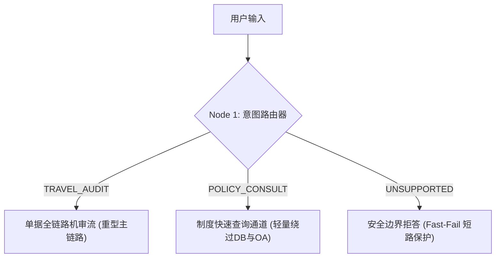
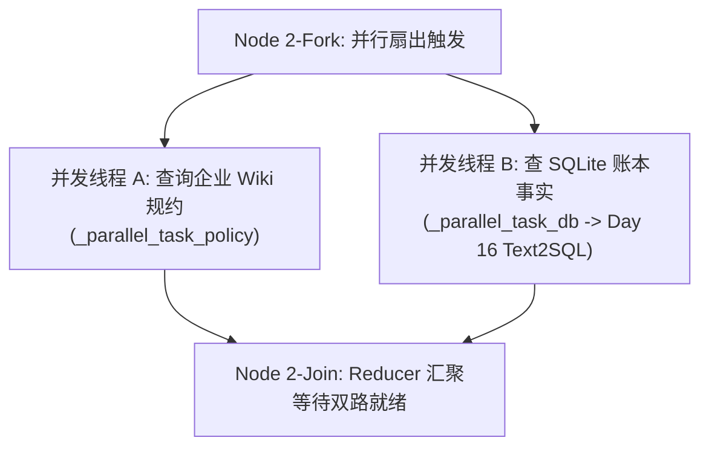
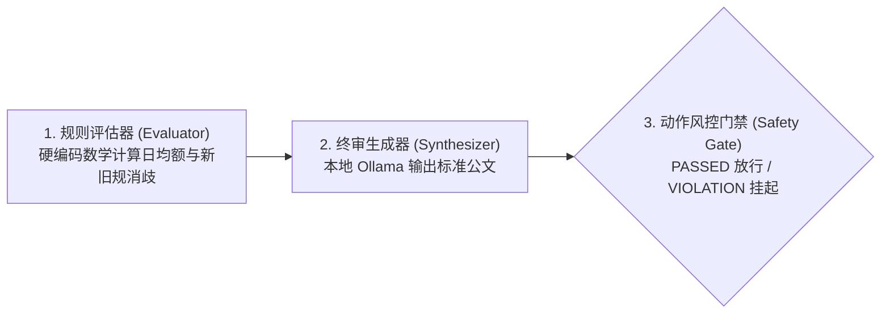

# 四大经典确定性设计模式

在 Anthropic 发布的架构军规《Building Effective Agents》以及 Day 17 讲义第二篇中，总结了构建企业生产级大模型系统的 **四大经典确定性设计模式**。

这四个模式分别解决 **“串行因果流”、“多意图分流”、“多源并发提速”** 与 **“复杂主从协同”** 四类经典企业痛点。以下详细拆解各个模式的**业务适用场景**以及在 [`day17/run_day17_workflow.py`](file:///Users/lucas/Documents/项目/武汉柯莱特企培/day17/run_day17_workflow.py) 中的**具体代码实现**：

---

### 模式全景对照与代码映射速查

| 设计模式                                             | 核心设计哲学                   | 典型业务应用场景                     | 在 `run_day17_workflow.py` 中的代码落地位置                                     |
|:------------------------------------------------ |:------------------------ |:---------------------------- |:---------------------------------------------------------------------- |
| **模式 1：Prompt 链式处理<br>(Prompt Chaining)**        | 任务分阶，步骤 B 强依赖步骤 A 的输出    | 财务合规机审 SOP、长文档合同逐级审查、简历解析筛选  | `run_workflow` 主干骨架（步骤 1 $\to$ 步骤 2 $\to$ 步骤 3 $\to$ 步骤 4）             |
| **模式 2：条件意图路由<br>(Routing)**                     | 前置分类，按意图分流到不同专有管道        | 企业综合服务台分流、退款/报修通道隔离、合规越界安全拒答 | `_route_intent` 方法与三大分支（机审流 / 咨询速查 / 越界拦截）                             |
| **模式 3：并行扇出与汇聚<br>(Parallelization)**            | 多任务无因果依赖，并发执行大幅缩短 P95 延迟 | 规章与账本并发核验、发票真伪+反欺诈并发审查、多模型投票 | `ThreadPoolExecutor` 并发跑 `_parallel_task_policy` 与 `_parallel_task_db` |
| **模式 4：主从协同与评估裁决<br>(Orchestrator / Evaluator)** | 规则硬核门禁计算 + 大模型规范撰写终审公文   | 复杂财务超标核算、代码生成与测试自愈、合同漏洞纠错    | 步骤 3 规则计算消歧 + 本地 Ollama 终审撰写 + 步骤 4 OA 写入/挂起                           |

---

### 一、模式 1：Prompt 链式处理 (Prompt Chaining)


#### 1. 适用应用场景

* **场景特征**：任务具有**明确的先后因果依赖性**（下一步必须拿到上一步的清洗产物）。
* **为什么不能用一个大 Prompt 一次性搞定？**
  如果把“提取单号、查制度、查数据库、核算超标、写审批意见”全塞进一个超长 Prompt，大模型极易发生**注意力稀释（Attention Dilution）**，漏看关键规章细节。
* **典型场景**：财务报销审批流、客服多轮跟进工单、法律合规文本三级审核。

#### 2. 在代码中是怎么使用的？

在 [`day17/run_day17_workflow.py`](file:///Users/lucas/Documents/项目/武汉柯莱特企培/day17/run_day17_workflow.py#L262-L390) 的 `run_workflow` 主体中，整个执行链条由硬编码顺序严格控制：

```python
# 链式状态机骨架：步骤之间输入输出严格衔接
intent = self._route_intent(user_query, trace)       # 步骤 1: 确定意图
# ...
policy_res, db_res = self._fetch_parallel_data(...)  # 步骤 2: 消费步骤 1 的单据，获取双路事实
# ...
final_decision, code = self._synthesize_decision(...) # 步骤 3: 消费步骤 2 的事实，核算并调用大模型
# ...
oa_status = self._dispatch_action(code, ...)          # 步骤 4: 消费步骤 3 的判定代码，决定写入或挂起
```

**工程收益**：零死循环、执行顺序 100% 确定可复现，完全阻断了自主 Agent“跳过查账直接打款”的风险。

---

### 二、模式 2：条件意图路由 (Routing)



#### 1. 适用应用场景

* **场景特征**：输入复杂多样，不同诉求所需的**底层工具、权限等级和响应成本截然不同**。
* **典型场景**：
  * **降本提速**：用户只是随口问句“总监去深圳能报多少钱”，根本不需要查底层数据库，更不能调用 OA 写入接口；
  * **安全截断（Fast-Fail）**：用户询问“公司能否无息贷款买房”，在第 1 毫秒直接短路拦截，不浪费昂贵的大模型推理 Token。

#### 2. 在代码中是怎么使用的？

在 [`day17/run_day17_workflow.py`](file:///Users/lucas/Documents/项目/武汉柯莱特企培/day17/run_day17_workflow.py#L210-L290) 中：

1. **分类网关实现**（`_route_intent`）：
   
   ```python
   # 利用轻量级分类 Prompt 或规则网关进行意图判定
   prompt = """将用户指令分类为：TRAVEL_AUDIT / POLICY_CONSULT / UNSUPPORTED..."""
   intent = self._route_intent(user_query, trace)
   ```

2. **业务分流与快速通道**：
   
   ```python
   if intent == "UNSUPPORTED":
       # 🛑 安全拒答分支：5ms 内返回，不调后续昂贵资源
       return {"success": False, "reason": "UNSUPPORTED_INTENT", ...}
   
   if intent == "POLICY_CONSULT":
       # ⚡ 制度速查通道：耗时仅 700ms，直接返回标准规约，完全绕过数据库与 OA 写入！
       return {"success": True, "type": "CONSULTATION", ...}
   
   # 🚀 只有确认为 TRAVEL_AUDIT，才启动重型并发机审流
   ```
   
   **工程收益**：在 Langfuse APM 大盘中可以看到，场景 3（咨询）相比场景 1（机审）**节省了 90% 以上的时延与数据库 I/O 压力**。

---

### 三、模式 3：并行扇出与汇聚 (Parallelization: Fork-Join)



#### 1. 适用应用场景

* **场景特征**：多个子任务之间**完全无数据依赖，可以同时进行**。
* **为什么必须并行？**
  如果串行执行：总时延 = 查规章 (20ms) + 查数据库 (20ms) = 40ms；  
  如果并行扇出：总时延 = $\max(20\text{ms}, 20\text{ms}) \approx 20\text{ms}$，直接将 I/O 耗时减半。
* **典型场景**：复杂机审（同时查历史违规库、征信库、发票验真库）、多模态输入处理、跨多个大区数据库并发汇总。

#### 2. 在代码中是怎么使用的？

在 [`day17/run_day17_workflow.py`](file:///Users/lucas/Documents/项目/武汉柯莱特企培/day17/run_day17_workflow.py#L318-L335) 中，采用 Python 标准库 `ThreadPoolExecutor`：

```python
# 开启多线程并行扇出
with ThreadPoolExecutor(max_workers=2) as executor:
    # 线程 1：去 Wiki 制度矩阵获取“标准上限”
    future_policy = executor.submit(self._parallel_task_policy, target_city_tier, target_role)
    # 线程 2：直接真实调用 Day 16 的 SafeText2SQLEngine 获取账本真实流水
    future_db = executor.submit(self._parallel_task_db, ticket_id)

    # 汇聚合并 (Join / Reducer)：等待双路数据均已完成
    policy_res = future_policy.result()
    db_res = future_db.result()
```

**APM 监控体现**：在控制台输出的 Langfuse 监控大盘中，可以清晰看到两个标记为 `PARALLEL_TASK` 的 Span 并行发生，随后由 `Parallel_Fork_Join_Reducer` 在 20ms 内完成同步。

---

### 四、模式 4：主从协同与评估优化 (Orchestrator / Evaluator)



#### 1. 适用应用场景

* **场景特征**：**“严苛的数据与法律判定”绝不能交给大模型口算，必须由规则引擎定性；但“人性化、规范化的公文报告”则适合交由大模型撰写**。
* **为什么不能完全信任大模型的判定？**
  大模型对浮点数乘除法经常算错，而且容易搞错 2024-03-01 这种微妙的法律生效日（前文王大明案例即是明证）。
* **典型场景**：财务审计追回裁决、合同法律漏洞修改建议、风控高危单据自动熔断。

#### 2. 在代码中是怎么使用的？

在 [`day17/run_day17_workflow.py`](file:///Users/lucas/Documents/项目/武汉柯莱特企培/day17/run_day17_workflow.py#L350-L400) 中：

1. **规则评估（Evaluator 负责确定性逻辑）**：
   
   ```python
   # 由 Python 代码完成刚性数学计算，严禁口算杜撰
   daily_avg = claimed_amt / days
   is_pre_policy = expense_date < "2024-03-01"
   effective_limit = 600.0 if is_pre_policy else standard_limit
   
   # 由代码给出硬核状态码：PASSED / VIOLATION
   code = "VIOLATION" if is_pre_policy and daily_avg > effective_limit else "PASSED"
   ```

2. **终审生成（大模型负责受约束润色）**：
   
   ```python
   # 将规则计算出的事实（日均额、超标差额、判定结论）固定为上下文喂给本地 Ollama Llama 3.1
   synthesis_prompt = f"""请作为财务审计专员，基于以下事实生成客观第三人称终审报告：
   员工：{name}，总额：{claimed_amt}，日均：{daily_avg}，上限：{effective_limit}，状态：{code}..."""
   ```

3. **物理安全网关（Safety Action Gate）**：
   
   ```python
   # 只有代码评估器判定为 PASSED，才真正调用 Day 16 的 ExternalAPIGateway 写入 OA；
   # 一旦判定为 VIOLATION，立刻阻断外部写入（RED INTERCEPTED），强制挂起转人工复核！
   if code == "PASSED":
       oa_res = self.api_gateway.call_oa_approval_api(...)
   elif code == "VIOLATION":
       oa_status_text = "🛑 【财务风控挂起】：单据存在违规追回记录，已中止自动放行，推送人工财务复核。"
   ```

---

### 总结：四个模式如何协同解决业务问题？

在 Day 17 的完整业务执行中，这四个模式是有机咬合在一起的：

1. 用户发来一句话，首先由 **Routing（模式 2）** 识别这是机审还是咨询；
2. 如果是机审，进入 **Prompt Chaining（模式 1）** 状态机主干；
3. 在获取上下文时，启动 **Parallelization（模式 3）** 同时并发查规章和查数据库，把时延压缩到极致；
4. 数据拿到后，进入 **Evaluator（模式 4）** 进行规则硬核计算与大模型报告生成，并在风控网关决定是自动写入 OA 还是阻断挂起。

全过程由 **Langfuse APM** 记录下每一个节点是 `ROUTER`、`PARALLEL_TASK` 还是 `GENERATION`，并精确计算出每一步消耗的毫秒与美金。
