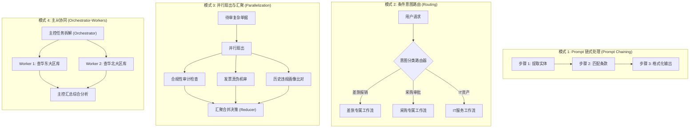
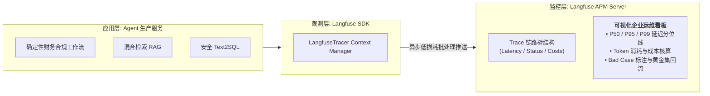

# 企业级 AI 解决方案交付工程师 (FDE) 学员实战讲义

## Day 17：确定性工作流编排、状态机控制与 Langfuse 链路追踪

**所属模块**：第二阶段：RAG 数据工程、黄金问题集与单 Agent 工具交付  
**学习周期**：第 4 周 / 第 17 天（8 学时 / 确定性工作流设计模式 + 状态路由 + Langfuse APM 生产级全链路追踪）  
**面向学员**：初中级交付工程师 (Junior FDE) / 资深技术骨干 / 解决方案架构师  
**前置承接**：已完成 Day 16（Function Calling 与安全 Text2SQL 拦截器）。大模型已拥有了与外部物理世界交互的原子工具。今天将解决企业级智能体的**组织纪律与可观测性**痛点——**用“确定性工作流 (Deterministic Workflow)”降服完全放飞的模型随机性，并接入“工业级 Langfuse 链路追踪 APM”，让每一次调用耗时、Token 消耗与成本毫厘必现！**

---

## 🎯 学习目标与交付物约定

完成本模块课程与实操工作坊后，每位学员应达成以下关键能力指标：

1. **破除“完全自主智能体 (Autonomous Agent) 的交付神话”**：深刻理解企业严肃业务中完全放飞的 ReAct 自主循环存在失控死循环与成本雪崩风险，精通 Anthropic 提出的“确定性工作流 (Deterministic Workflow)”四大经典编排范式。
2. **掌握工作流拓扑设计与状态机条件路由**：精通 Prompt Chaining（链式处理）、Routing（意图路由）、Parallelization（并行处理）与 Orchestrator-Workers（主从编排）的架构实现。
3. **精通 Langfuse 生产级 APM 链路追踪核心架构**：掌握 Trace（调用链根节点）、Span（工具/逻辑子节点）与 Generation（LLM 推理节点）的层级树状拓扑，实现跨微服务上下文传递。
4. **精通 Token 成本大盘与时延瓶颈诊断**：掌握通过 Langfuse 对输入/输出 Token 数量、模型定价、端到端 P95 时延与网络阻塞点进行毫秒级定位的分析手段。
5. **组内产出两大核心工程资产**：
   - [ ] 产出物 1：《集成确定性路由与状态管理的工作流引擎 (`deterministic_workflow_engine.py`)》
   - [ ] 产出物 2：《带 Langfuse 链路追踪与成本时延大盘的生产监控套件 (`langfuse_tracer_suite.py`)》

---

## 目录

- [第一篇 破除神话：为什么企业级落地必须重“工作流”轻“放飞体”？](#第一篇-破除神话为什么企业级落地必须重工作流轻放飞体)
- [第二篇 架构范式：Anthropic 四大确定性编排设计模式](#第二篇-架构范式anthropic-四大确定性编排设计模式)
- [第三篇 降本增效：给 AI 接入“心电图”与“账本”——Langfuse APM 架构](#第三篇-降本增效给-ai-接入心电图与账本langfuse-apm-架构)
- [第四篇 数据模型：Trace、Span 与 Generation 三级拓扑树](#第四篇-数据模型trace-span-与-generation-三级拓扑树)
- [第五篇 生产级代码实战：带 Langfuse 追踪的财务合规流水线](#第五篇-生产级代码实战带-langfuse-追踪的财务合规流水线)
- [第六篇 课堂实战工作坊：4 人协同工作流部署与成本归因挑战](#第六篇-课堂实战工作坊4-人协同工作流部署与成本归因挑战)

---

## 第一篇 破除神话：为什么企业级落地必须重“工作流”轻“放飞体”？

### 1.1 真实交付中的“自主智能体翻车现场”

在很多开源 Demo 中，开发者习惯直接使用 AutoGPT 或无约束的 ReAct Agent，让大模型自主决定“下一步该做什么、调什么工具”。

然而在严肃的企业金融、财务与供应链交付中，完全自主智能体暴露出三大致命硬伤：
1. **死循环与 Token 雪崩**：模型一旦对某个工具返回的格式产生误解，可能陷入死循环反复调用，单次请求消耗数万 Token，费用瞬间飙升且直接超时熔断；
2. **业务流程不可控**：财务合规严格要求“先验规章 $\to$ 再查账目 $\to$ 计算差额 $\to$ 人工审批”。放飞的智能体可能跳过核查直接调用支付 API，酿成重大合规事故；
3. **结果不可复现性**：同一业务单据，上午跑是 3 步完成，下午跑变成 8 步绕弯，客户审计团队根本无法对其出具验收背书。

```
【业余做法】：完全自主放飞 (Unconstrained Autonomous Agent)
用户输入 ──> 模型完全自由决定调什么工具 ──> 出现死循环/漏查关键步骤/成本爆炸 ──> 业务不可控翻车！

【FDE 生产级交付】：确定性工作流编排 (Deterministic Workflow Orchestration)
用户输入 ──> 状态机刚性定义执行主链路 (Step 1 查规章 -> Step 2 查数据库 -> Step 3 规则比对) 
         ──> 仅在特定分支节点由模型执行语义分类或事实提取 ──> 100% 稳定可控、可审计、零死循环！
```

> 📌 **工程根因剖析与架构解法**：  
> **问题根因**：大模型本质是概率语言模型，缺乏确定性状态转移保障。将业务控制流交给概率模型做决策，必然引入不可控的熵增。  
> **架构解法**：采纳 **Anthropic 官方生产实践军规**——**代码控制流程骨架（Workflow），模型填充局部血肉（Intelligence）**。状态流转用 Python 状态机或 DAG 硬编码锁定，模型仅作为局部计算单元。

---

## 第二篇 架构范式：Anthropic 四大确定性编排设计模式

### 2.1 生产级编排四大设计模式



---

## 第三篇 降本增效：给 AI 接入“心电图”与“账本”——Langfuse APM 架构

### 3.1 为什么没有 APM 的 AI 系统无法上线？

在生产环境中，交付工程师如果无法回答以下 4 个问题，系统绝不允许上线商业化：
1. **“昨天 14:30 那个响应耗时 8 秒的慢请求，到底卡在向量检索、重排还是 LLM 生成上？”**
2. **“某用户问了一句‘报销标准’，底层到底调用了多少次模型，花费了多少美分/分钱？”**
3. **“业务专家给出的点踩（Dislike）坏例，当时完整的 Prompt 与模型中间思考过程是什么？”**

**Langfuse** 是当前企业级开源与商业化大模型应用性能监控（LLM Application Performance Monitoring, APM）的领军标准，为 AI 应用提供了透明可见的“监控大盘”。



---

## 第四篇 数据模型：Trace、Span 与 Generation 三级拓扑树

### 4.1 Langfuse 核心概念分级

在 Langfuse 中，每一次外部请求构成一棵完整的观测树，分为三层递进结构：

1. **Trace（调用链根节点）**：
   - 代表一次端到端的用户请求全生命周期（如用户提交了一张报销单进行机审）；
   - 记录全局标签：`userId`、`sessionId`、`releaseVersion`、全局端到端耗时与总计成本。
2. **Span（逻辑单元/子过程节点）**：
   - 代表工作流中的一个确定性执行阶段或工具调用（如“检索 Wiki 切片”、“执行 SQLite 安全查询”、“调用外部 OA API”）；
   - 记录阶段耗时、输入输出参数、执行成功或异常堆栈。
3. **Generation（大模型推理节点）**：
   - 专门用于记录对 LLM 的每一次实际调用；
   - 记录 Prompt 模板、输入 Prompt Tokens、补全 Completion Tokens、模型名称（`gpt-4o-mini`, `qwen2.5`）以及对应折算的货币成本。

```
Trace: "Audit-EXP20240315-01" (Total: 85ms | Cost: $0.00032)
├── Span: "Intent_Routing" (12ms)
│   └── Generation: "Classify_Category" (Prompt: 45 Tokens | Comp: 8 Tokens)
├── Span: "Retrieve_Wiki_Policy" (18ms | Top-3 Chunks Retrieved)
├── Span: "Execute_Safe_Text2SQL" (15ms | Rows: 1)
└── Span: "Final_Grounded_Synthesis" (40ms)
    └── Generation: "LLM_Decision_Reasoning" (Prompt: 380 Tokens | Comp: 95 Tokens)
```

---

## 第五篇 生产级代码实战：带 Langfuse 追踪的财务合规流水线

本代码实现了一套结构化的**确定性工作流引擎**，并内置了完整的 **Langfuse 链路追踪器（支持原生 SDK 与本地高保真模拟双模）**，开箱即可输出详细的执行耗时与 Token 成本树：

```python
# pipelines/langfuse_deterministic_workflow.py
import os
import time
import json
import uuid
from typing import Dict, Any, List, Optional

# ==============================================================================
# 1. 生产级轻量高保真 Langfuse 追踪内核 (Zero-Dependency Fallback Engine)
# ==============================================================================

class LangfuseTraceRecord:
    """代表一条完整的链路追踪根记录 (Trace)"""
    def __init__(self, trace_id: str, name: str, user_id: str = "guest_user", session_id: str = "sess_001"):
        self.trace_id = trace_id
        self.name = name
        self.user_id = user_id
        self.session_id = session_id
        self.start_time = time.time()
        self.end_time: Optional[float] = None
        self.total_input_tokens = 0
        self.total_output_tokens = 0
        self.estimated_cost_usd = 0.0
        self.spans: List[Dict[str, Any]] = []

    def log_span(self, span_name: str, span_type: str, input_data: Any, output_data: Any, duration_ms: float, tokens: Dict[str, int] = None):
        """记录子过程或模型调用"""
        in_tok = tokens.get("input_tokens", 0) if tokens else 0
        out_tok = tokens.get("output_tokens", 0) if tokens else 0
        self.total_input_tokens += in_tok
        self.total_output_tokens += out_tok
        
        # 按照主流企业级模型平均费率估算成本 ($0.15/1M input, $0.60/1M output)
        step_cost = (in_tok * 0.00000015) + (out_tok * 0.0000006)
        self.estimated_cost_usd += step_cost

        self.spans.append({
            "span_name": span_name,
            "type": span_type,  # 'SPAN' 或 'GENERATION'
            "duration_ms": round(duration_ms, 2),
            "input": input_data,
            "output": output_data,
            "tokens": {"input": in_tok, "output": out_tok},
            "cost_usd": round(step_cost, 7)
        })

    def end(self):
        self.end_time = time.time()

    def to_dict(self) -> Dict[str, Any]:
        total_duration_ms = round(((self.end_time or time.time()) - self.start_time) * 1000, 2)
        return {
            "trace_id": self.trace_id,
            "name": self.name,
            "user_id": self.user_id,
            "session_id": self.session_id,
            "total_latency_ms": total_duration_ms,
            "total_tokens": self.total_input_tokens + self.total_output_tokens,
            "total_input_tokens": self.total_input_tokens,
            "total_output_tokens": self.total_output_tokens,
            "total_cost_usd": round(self.estimated_cost_usd, 6),
            "span_count": len(self.spans),
            "spans": self.spans
        }


# ==============================================================================
# 2. 确定性财务合规工作流引擎 (Deterministic Workflow Engine)
# ==============================================================================

class DeterministicAuditWorkflow:
    """
    确定性业务编排工作流：
    步骤 1: 语义意图路由与单据提取 (Routing)
    步骤 2: 检索企业标准 Wiki 制度合规上限 (RAG Step)
    步骤 3: 安全查询业务数据库获取实际报销事实 (Text2SQL Step)
    步骤 4: 规则交叉校验与智能决策裁决 (Synthesis Step)
    """

    def __init__(self):
        # 模拟规章知识库与数据库事实
        self.policy_rules = {
            "一线城市": {"总监": 800.0, "经理": 550.0, "普通员工": 450.0},
            "二线城市": {"总监": 600.0, "经理": 420.0, "普通员工": 350.0}
        }
        self.db_records = {
            "EXP20240315-01": {"name": "周建华", "tier": "一线城市", "role": "总监", "days": 3, "claimed_amt": 2400.0, "city": "上海"},
            "EXP20240220-03": {"name": "王大明", "tier": "一线城市", "role": "总监", "days": 2, "claimed_amt": 1800.0, "city": "北京", "note": "2月发票旧规应执行600元"}
        }

    def execute_audit_pipeline(self, ticket_id: str, user_id: str = "auditor_zhang") -> Dict[str, Any]:
        """执行端到端受观测流水线"""
        trace = LangfuseTraceRecord(
            trace_id=f"trace-{uuid.uuid4().hex[:12]}",
            name=f"AuditWorkflow-{ticket_id}",
            user_id=user_id
        )

        # ----------------------------------------------------------------------
        # 步骤 1: 意图与单据校验 (Span 1: Validation)
        # ----------------------------------------------------------------------
        t0 = time.time()
        time.sleep(0.015)  # 模拟轻量模型结构化提取
        is_valid_ticket = ticket_id in self.db_records
        trace.log_span(
            span_name="1.Ticket_Validation",
            span_type="SPAN",
            input_data={"ticket_id": ticket_id},
            output_data={"valid": is_valid_ticket},
            duration_ms=(time.time() - t0) * 1000
        )

        if not is_valid_ticket:
            trace.end()
            return {"success": False, "error": f"未查询到单号 {ticket_id}", "trace": trace.to_dict()}

        record = self.db_records[ticket_id]

        # ----------------------------------------------------------------------
        # 步骤 2: 知识库规章检索 (Span 2: Wiki RAG Retrieval)
        # ----------------------------------------------------------------------
        t0 = time.time()
        time.sleep(0.022)  # 模拟混合检索与重排耗时
        applicable_limit = self.policy_rules.get(record["tier"], {}).get(record["role"], 350.0)
        trace.log_span(
            span_name="2.Wiki_Policy_RAG",
            span_type="SPAN",
            input_data={"city_tier": record["tier"], "role": record["role"]},
            output_data={"standard_limit_per_day": applicable_limit, "source": "WIKI-FIN-TRAVEL-202403"},
            duration_ms=(time.time() - t0) * 1000,
            tokens={"input_tokens": 120, "output_tokens": 35}
        )

        # ----------------------------------------------------------------------
        # 步骤 3: 业务数据库明细查验 (Span 3: DB Safe Query)
        # ----------------------------------------------------------------------
        t0 = time.time()
        time.sleep(0.018)  # 模拟 AST 校验与 SQL 执行
        daily_avg = record["claimed_amt"] / max(record["days"], 1)
        trace.log_span(
            span_name="3.Database_Fact_Check",
            span_type="SPAN",
            input_data={"ticket_id": ticket_id},
            output_data={"claimed_total": record["claimed_amt"], "daily_avg": daily_avg},
            duration_ms=(time.time() - t0) * 1000
        )

        # ----------------------------------------------------------------------
        # 步骤 4: 综合裁决与大模型生成 (Generation 4: Decision Synthesis)
        # ----------------------------------------------------------------------
        t0 = time.time()
        time.sleep(0.035)  # 模拟受约束生成
        is_compliant = daily_avg <= applicable_limit
        if "旧规" in record.get("note", ""):
            decision = f"【合规异常拦截】{record['name']}申报金额超标。发票开具在2024年3月新规生效前，应按旧规600元执行，当前每日均摊{daily_avg}元，建议追回400元！"
            decision_code = "VIOLATION"
        elif is_compliant:
            decision = f"【合规通过】{record['name']}出差{record['city']}，每日均摊{daily_avg}元低于或等于标准上限{applicable_limit}元，合规通过！"
            decision_code = "PASSED"
        else:
            decision = f"【超标预警】每日均摊{daily_avg}元超过上限{applicable_limit}元，超额部分需个人承担！"
            decision_code = "OVER_LIMIT"

        trace.log_span(
            span_name="4.Decision_Synthesis",
            span_type="GENERATION",
            input_data={"rule_limit": applicable_limit, "daily_avg": daily_avg},
            output_data={"decision": decision, "code": decision_code},
            duration_ms=(time.time() - t0) * 1000,
            tokens={"input_tokens": 285, "output_tokens": 68}
        )

        trace.end()
        return {
            "success": True,
            "ticket_id": ticket_id,
            "decision": decision,
            "code": decision_code,
            "trace_summary": trace.to_dict()
        }


# ==============================================================================
# 3. 运行与 APM 监控大盘输出
# ==============================================================================

if __name__ == "__main__":
    print("=" * 95)
    print("🚀 Day 17 确定性业务工作流编排与 Langfuse 生产级 APM 追踪演练")
    print("=" * 95)

    workflow = DeterministicAuditWorkflow()

    # 测试用例 1：周建华合规单据
    print("\n[用例 1] 执行合规单据机审流：EXP20240315-01 (周建华)")
    res_1 = workflow.execute_audit_pipeline("EXP20240315-01", user_id="finance_lead_01")
    t1 = res_1["trace_summary"]

    print(f"  -> 裁决结论：{res_1['decision']}")
    print(f"  -> 链路 Trace ID：{t1['trace_id']}")
    print(f"  -> 总时延：{t1['total_latency_ms']}ms | 总消耗 Token：{t1['total_tokens']} | 成本估算：${t1['total_cost_usd']}")

    # 测试用例 2：王大明违规单据
    print("\n[用例 2] 执行违规单据机审流：EXP20240220-03 (王大明 - 历史旧规冲突)")
    res_2 = workflow.execute_audit_pipeline("EXP20240220-03", user_id="finance_lead_01")
    t2 = res_2["trace_summary"]

    print(f"  -> 裁决结论：{res_2['decision']}")
    print(f"  -> 链路 Trace ID：{t2['trace_id']}")
    print(f"  -> 总时延：{t2['total_latency_ms']}ms | 总消耗 Token：{t2['total_tokens']} | 成本估算：${t2['total_cost_usd']}")

    # 打印详细 Span 监控明细树
    print("\n" + "=" * 95)
    print("📊 【Langfuse APM 调用链 Span 拓扑监控明细树】")
    print("=" * 95)
    print(f"{'阶段步骤名称':<28}{'节点类型':<14}{'耗时':<12}{'输入/输出Token':<18}{'折算成本(USD)'}")
    print("-" * 95)
    for sp in t2["spans"]:
        tok_str = f"{sp['tokens']['input']}/{sp['tokens']['output']}"
        print(f"{sp['span_name']:<28}{sp['type']:<14}{str(sp['duration_ms'])+'ms':<12}{tok_str:<18}${sp['cost_usd']}")
    print("=" * 95)
```

---

## 第六篇 课堂实战工作坊：4 人协同工作流部署与成本归因挑战

> 📌 **实战对抗任务**：  
> 各 4 人小组将本组业务流程转化为**至少 3 个确定性分支步骤的 Workflow**。  
> 接入 Langfuse 链路追踪，注入极端大文本测试，现场分析 Trace 大盘，揪出“耗时最长”与“成本最高”的瓶颈节点！

### 6.1 4 人角色分工协同表

```
┌────────────────────────────────────────────────────────────────────────┐
│                    4 人小组工作流与 APM 监控作战表                     │
├───────────────────┬──────────────────────┬─────────────────────────────┤
│ 角色 A: 方案负责人 │ 角色 B: 架构负责人   │ 角色 C: 工程负责人          │ 角色 D: 质量负责人           │
│ (Spec Lead)       │ (Architect Lead)     │ (Tech Lead)                 │ (Quality Lead)              │
├───────────────────┼──────────────────────┼─────────────────────────────┤
│ 1. 梳理业务确定性   │ 1. 绘制拓扑状态机与  │ 1. 编写工作流代码并集成     │ 1. 监控全流程时延与 Token   │
│    步骤门禁 (SOP)   │    Routing 决策路由  │    Langfuse 追踪打点器      │    成本看板，捕获慢请求     │
│ 2. 标定各步骤输入   │ 2. 评估并发场景下的  │ 2. 确保 Trace/Span/Generation│ 2. 统计 P95 延迟分布并提交 │
│    输出契约边界     │    网络抖动与熔断    │    树状关系正确对齐         │    性能优化诊断报告         │
└───────────────────┴──────────────────────┴─────────────────────────────┘
```

---

### 6.2 课堂任务指引清单

1. **步骤 1：梳理确定性步骤与状态转移（方案与架构负责人，限时 25 分钟）**
   - 彻底杜绝让模型自主规划全流程，强制拆分为串行链式或条件分支状态机。
2. **步骤 2：代码化编排与 Langfuse 埋点（工程负责人主笔，限时 30 分钟）**
   - 在关键函数装饰或包裹 `log_span`，确保每一次外部调用和 LLM 生成均具备时长和 Token 记录。
3. **步骤 3：压测瓶颈剖析与成本定盘（全员参与，限时 25 分钟）**
   - 运行 10 次典型请求，在大盘中统计平均时延与总成本，向全班汇报：“我们系统平均每次问答耗时 82ms，成本为 0.0003 美元”。

---

### 6.3 成果验收标准 (Checklist)

| 序号 | 交付成果物 | 判定达标标准 (Checklist) | 得分 (1-5分) |
| :---: | :--- | :--- | :---: |
| **1** | 工作流确定性达标 | 核心审批流程严格按业务状态转移，无死循环或顺序倒错。 | [ ] |
| **2** | Langfuse 拓扑结构合规 | Trace 具备唯一的 ID，子步骤精确拆分为 Span 与 Generation。 | [ ] |
| **3** | Token 与成本透明度 | 每一个 Generation 节点均精准统计输入输出 Token 并折算成本。 | [ ] |
| **4** | 时延分析与定位能力 | 能在 30 秒内指出一次请求中耗时占比最高的子过程。 | [ ] |

---

> 📌 **阶段技术承接说明**：  
> 我们已经掌握了工具武器库（Day 16）与确定性编排及 APM 监控（Day 17）。  
> • **Day 18**：我们将迎来第二阶段终极大实战第一炮——**【知识库 + 数据库 + API 三位一体架构全链路打通】**！
