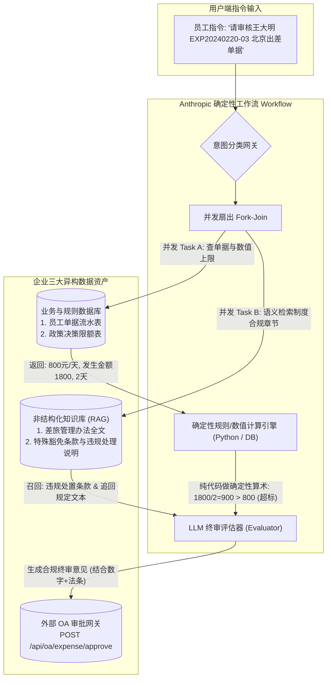

# 系统边界划分（System Boundary Separation）

在企业级生产架构与工程落地实践中，需注意一个非常核心且深刻的 **系统边界划分（System Boundary Separation）** 问题。

> **标准答案是：硬性裁决数值必须沉淀在“规则配置数据库 / 规则引擎决策表（Decision Table）”中；而制度文本、合规依据与条文解释，则沉淀在“非结构化知识库（RAG）”中。**
> 
> **绝对不能把这种硬性的“数值判定矩阵”仅仅交给纯非结构化向量知识库（RAG）召回后让大模型心算！**
> 当前 [`day17/run_day17_workflow.py`](file:///Users/lucas/Documents/项目/武汉柯莱特企培/day17/run_day17_workflow.py#L202-L205) 中的 `self.policy_matrix` 属于**为了聚焦解耦验证 Anthropic 编排设计模式与 APM 链路的内存规约实现**。在完整的企业级生产系统（乃至课程第 18 天的“三位一体”架构）中，二者有着严格的职责分工。

---

### 一、 为什么数值矩阵“绝不能只靠知识库（RAG）检索”？

如果将 `一线城市-总监-800元/天` 仅仅作为一段 Markdown 规章文本丢进向量库，让智能体在每次审计时通过语义向量检索出来并由大模型做判定，在企业级生产环境中会触发三大致命缺陷：

```
❌ 纯 RAG 数值判定的生产隐患链路：
用户单据 -> 语义向量召回 -> Top-K 文本切片 -> 大模型阅读长提示词 -> 大模型浮点心算 -> 产生幻觉/漏判
```

1. **向量检索对数值与表格对齐的不可靠性（Embedding Blindness）**
   - 现有的稠密向量模型（如 `bge-m3`、`nomic-embed-text`）本质是基于语义分布计算余弦相似度，对微小的数字差异（800 与 600）、表格行列的绝对对齐映射极其迟钝。
   - 向量检索往往能准确召回“差旅标准章节”，但提取表格单元格交叉值（“总监”且“一线城市”是 800 还是 550）时，极易发生召回截断或行列错配。
2. **大模型的浮点数运算与边界判定幻觉（Math & Logic Hallucination）**
   - 大模型本质是概率生成模型，非确定性计算器。
   - 若让 LLM 抽取“800元/天”后自行计算 `总金额 2400 / 3天 = 800 <= 800`，在面临复杂日期折算、扣除免税额、阶梯超标等长提示词场景下，极易产生计算幻觉（例如得出 2400/3=750 的算术错误），导致财务违规放行或误驳回。
3. **缺乏时间生效窗口的事务级回溯能力（Point-in-time Auditability）**
   - 企业的制度通常具有强烈的版本时效性。例如：
     - *2024-03-01 之后发生的事项执行新规（北京总监 800 元/天）；*
     - *2024-03-01 之前发生的事项执行旧规（北京总监 700 元/天）。*
   - 向量数据库很难对非结构化切片做毫秒级、强事务性的 `WHERE expense_date >= effective_start` 时间区间版本过滤。

---

### 二、 放在数据库中的生产级形态：业务规则决策表（Decision Table）

在真正的中台架构中，这部分内容属于 **“规则配置主数据 / 决策表”**，通常存储在关系型数据库（如 PostgreSQL / MySQL）或配置中心（如 Nacos / Apollo / Drools 规则引擎）中。

#### 1. 生产级数据库表结构设计（DDL 规范）

```sql
-- 企业差旅标准规则决策表 (只读配置表)
CREATE TABLE sys_policy_travel_limits (
    policy_id       VARCHAR(32)    NOT NULL COMMENT '制度唯一编号，如 WIKI-FIN-TRAVEL-202403',
    city_tier       VARCHAR(16)    NOT NULL COMMENT '城市级别: 一线城市 / 二线城市 / 三线及以下',
    employee_level  VARCHAR(16)    NOT NULL COMMENT '员工职级: 总监 / 经理 / 普通员工',
    daily_limit     DECIMAL(10, 2) NOT NULL COMMENT '单日住宿与差旅标准上限(强类型高精度浮点)',
    effective_start DATE           NOT NULL COMMENT '政策生效日期，如 2024-03-01',
    effective_end   DATE           NOT NULL COMMENT '政策失效日期，如 9999-12-31',
    wiki_anchor_uri VARCHAR(128)   NOT NULL COMMENT '关联的知识库原文锚点: wiki://fin/travel_2024#sec_4_2',
    PRIMARY KEY (policy_id, city_tier, employee_level, effective_start)
);

-- 插入基线数据
INSERT INTO sys_policy_travel_limits VALUES 
('WIKI-FIN-TRAVEL-202403', '一线城市', '总监', 800.00, '2024-03-01', '9999-12-31', 'wiki://travel_2024#sec_4_2'),
('WIKI-FIN-TRAVEL-202403', '一线城市', '经理', 550.00, '2024-03-01', '9999-12-31', 'wiki://travel_2024#sec_4_2'),
('WIKI-FIN-TRAVEL-202403', '一线城市', '普通员工', 450.00, '2024-03-01', '9999-12-31', 'wiki://travel_2024#sec_4_2');
```

#### 2. 数据库存储的核心价值

* **100% 确定性与零幻觉**：直接通过 SQL 或内存哈希执行 `SELECT daily_limit WHERE ...`，数值精度达到 100%。
* **版本与时间穿梭（Time-Travel）**：输入单据出差日期，SQL 一条语句精确圈定当时对应的历史标准（完美解决旧规追回与新规结案）。
* **配置热更新**：财务部修改标准只需在管理后台改一行数据库，无需重新分块、向量化重建知识库。

---

### 三、 既然存数据库，为什么还需要非结构化“知识库（RAG）”？

将数值存入数据库后，**绝不意味着可以丢掉知识库**。知识库与数据库分工明确，各司其职：

| 维度         | 数据库 / 规则决策表（SQL / DB）                                   | 非结构化知识库（RAG / 向量库）                                                          |
|:---------- |:------------------------------------------------------- |:--------------------------------------------------------------------------- |
| **数据形态**   | 结构化、强类型数值（800.00 元、3天）                                  | 自然语言、规章制度、合同文本、补充通知                                                         |
| **负责领域**   | **量化判定**（算术、求和、上限比对、布尔条件）                               | **质性分析与合规解释**（定义、豁免、依据说明、例外场景）                                              |
| **核心场景举例** | - 计算单日均摊：`2400 / 3 = 800`<br>- 判定是否超标：`800 <= 800` (合规) | - 判定特殊条款：“随行总监出差，普通员工可否同住四星级并按总监标准报销？”<br>- 违规事实定性：“因暴雪滞留机场产生的改签费是否计入差旅配额？” |
| **审计溯源**   | 记录判定代码与数值快照                                             | 提取制度全文、出处章节（如《第四章第二条》）生成审计批注                                                |
| **员工交互**   | 账本单据流水查询                                                | 员工随口咨询制度细节、免责条件及申请指南                                                        |

---

### 四、 工业界最佳落地模式：“三位一体”协同架构（Day 18 进阶形态）

在企业级智能化系统全链路中，业界公认的最佳实践是 **“三位一体协同（Triad Architecture）”**：



1. **并行检索**：工作流同时发起两个任务：
   - 任务 1：从**数据库**读取单据明细（单号、金额、城市、职级）及对应的标准上限（数值）；
   - 任务 2：从**知识库**检索该制度对应的法律法条、合规解释原文切片（非结构化证据）。
2. **确定性算术交由代码计算**：`超标额 = 实际日均 - 规则库上限`，由 Python 逻辑计算，得到 100% 精确的差额。
3. **质性解释与结案交由大模型生成**：大模型接收“计算好的确定性数值事实”和“知识库召回的制度条文”，综合组织成严谨合规的公文回复。
4. **动作门禁写入**：校验无误后，通过 API 网关真实推入 OA 系统。

---

### 五、 源码设计考量：为什么 Day 17 代码写成了内存字典？

在 [`day17/run_day17_workflow.py`](file:///Users/lucas/Documents/项目/武汉柯莱特企培/day17/run_day17_workflow.py) 中，`self.policy_matrix` 设计为类的属性字典，主要基于以下**教学交付与工程解耦考量**：

1. **关注点分离（Separation of Concerns）**：
   
   - Day 17 的核心验收目标是 **Anthropic 官方生产实践四大模式（Prompt Chaining, Routing, Parallelization, Evaluator）** 与 **Langfuse APM 链路追踪监控**。
   - 如果在 Day 17 脚本中强行引入完整的向量数据库检索（Chroma / Milvus / 复杂的 Embedding 模型加载），会导致运行环境依赖急剧上升，掩盖了工作流编排本身的教学核心。

2. **模拟向量库微秒级时延**：
   在 `_parallel_task_policy` 函数中特别保留了网络与检索的时延模拟：
   
   ```python
   def _parallel_task_policy(self, city_tier: str, role: str) -> Dict[str, Any]:
       t0 = time.time()
       time.sleep(0.018)  # 模拟向知识库向量检索发起 RPC 的微秒级耗时
       limit = self.policy_matrix.get(city_tier, {}).get(role, 350.0)
       return {
           "tier": city_tier,
           "role": role,
           "daily_limit": limit,
           "wiki_doc": "WIKI-FIN-TRAVEL-202403",
           "duration_ms": (time.time() - t0) * 1000
       }
   ```
   
   这为后续无缝替换为真实的知识库客户端（如 `rag_client.search(...)`）留出了标准的微服务接口适配插槽。

3. **通向 Day 18 的承上启下**：
   
   - **Day 11 ~ Day 15**：深耕**非结构化知识库**工程（切片、多路召回、重排、RAGAS 评估）；
   - **Day 16**：深耕**数据库与 API 弹性工具**（SafeText2SQL 拦截器、幂等性 API 网关）；
   - **Day 17**：深耕**工作流编排与 APM 链路**（确定性状态机、并行扇出、Langfuse 观测）；
   - **Day 18**：**三位一体架构大决战**——此时将真正把 Day 15 的向量知识库检索、Day 16 的安全 SQL 数据库与 API 网关、Day 17 的工作流中枢完整拼装在一起，形成全闭环的企业级 Agent！
